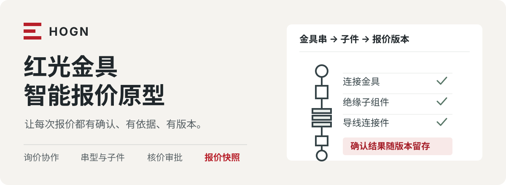

<p align="center">
  
</p>

# 红光金具智能报价原型

面向销售、技术与财务的业务交互原型，用一条可演示的流程串起**询价协作、金具串检索、项目 BOM、核价审批和报价签发**。

[阅读整合 PRD](docs/正式项目需求文档_红光金具智能报价系统_2026-09-08.md) · [查看演示脚本](docs/demo/领导演示脚本与问答_2026-09-08.md) · [本地启动](#本地启动)

## 一条报价主线

<p align="center">
  
</p>

| 环节 | 原型中可以体验的操作 |
| --- | --- |
| 询价协作 | 新建与切换项目、登记资料、补充缺失条件、分派销售与技术处理事项 |
| 串型检索 | 根据编码、串型号与图册线索比较候选，检查电压和导线条件，记录采用依据 |
| 项目 BOM | 汇总已确认串的子件，按客户参考结构导出 XLSX，保留用量与来源 |
| 核价审批 | 财务保存核价，按配置推进审批；董事长可按单价或目标毛利率调价并返回复核 |
| 报价档案 | 签发并冻结报价快照，导出 CSV；创建新版本后重新确认，保留旧快照 |

销售确认需求与范围，技术确认串型和复核结果。两侧确认与阻断检查共同决定是否进入核价；核价、审批和签发沿着当前版本推进。

## 本地启动

使用 **Node.js 22.18+**。本地验证环境为 Node.js 24.18。

```bash
npm ci
npm run dev
```

## Vercel 部署

仓库已提供 `vercel.json` 和 GitHub Actions：推送到 `master` 或 `main` 会先执行构建与测试，再使用 Vercel CLI 发布生产版本。首次启用 Actions 时，在 GitHub 仓库 Secrets 中配置 `VERCEL_TOKEN`、`VERCEL_ORG_ID` 和 `VERCEL_PROJECT_ID`。其中项目 ID 与组织 ID 从 Vercel 项目设置或 `vercel link` 生成的项目配置中取得。

打开终端显示的地址，通常是 [http://localhost:5173/](http://localhost:5173/)。开发服务监听局域网地址，同网设备可使用终端中的 Network 地址访问。

| 命令 | 用途 |
| --- | --- |
| `npm run dev` | 启动开发服务 |
| `npm run build` | 生成 `dist/` 构建产物 |
| `npm run preview` | 预览构建结果，默认端口 4173 |
| `npm test` | 执行版本、权限、检索与审批规则测试 |

## 第一次演示

1. 打开示例询价，在顶部切换销售、技术、财务或董事长角色。
2. 销售在“询价协作”补充货物项 02 的导线条件，示例值为 `300/40`，记录确认来源并确认需求与范围。
3. 技术处理图册问题，在“串型检索”比较候选并填写采用依据，再确认技术结果。
4. 双确认与门禁通过后提交财务核价，填入演示价格、保存并推进审批。
5. 完成审批后签发报价，查看冻结快照及导出结果；新建报价版本可体验重新确认流程。

完整操作、模拟填写内容和现场问答见[演示脚本](docs/demo/领导演示脚本与问答_2026-09-08.md)。使用无痕窗口或独立浏览器配置预演，“重置演示”会恢复初始样例。

## 数据与能力边界

这是用于需求沟通与交互验证的浏览器原型。正式系统的交付范围和验收依据见[整合 PRD](docs/正式项目需求文档_红光金具智能报价系统_2026-09-08.md)。

- **候选数据**：`src/data/catalog.json` 包含用户提供的金具拆解资料节选，共 22 组记录，串与子件保留源行号。人员、数量、项目组合、风险场景和价格为演示数据。
- **资料解析**：上传仅登记文件信息并展示预置结果；真实 ZIP 处理、混合文件关联、模型解析、U9 接入及图册页码定位尚未接入。
- **项目保存**：多个项目及报价快照保存在浏览器 `localStorage`，可本地切换。角色切换用于演示，生产登录、多人协作和服务端授权仍需正式实现。
- **导出能力**：项目 BOM 支持 XLSX，报价支持演示 CSV。正式报价 Excel/PDF 与签章需后续集成；部分内嵌浏览器可能限制下载。
- **规则范围**：字典与图册数据为节选；二、三阶段能力在页面中演示。正式规则发布、数据治理与受影响项复审按 PRD 实施。

## 项目导航

```text
src/
├── components/     业务页面与共用组件
├── domain/         业务对象、状态变更、检索与审批规则
├── data/           候选节选、字典、风险规则与本地图标
└── lib/            通用工具与 BOM 导出
tests/              业务规则测试
assets/readme/      可编辑的 README SVG
docs/               需求、演示与历史追溯资料
```

- [整合 PRD v1.9](docs/正式项目需求文档_红光金具智能报价系统_2026-09-08.md)：当前需求的唯一阅读入口，包含业务、角色、接口和验收要求。
- [演示脚本与问答](docs/demo/领导演示脚本与问答_2026-09-08.md)：操作顺序与演示说明。
- `docs/reviews/` 与 `docs/archive/`：复核与历史资料，供追溯使用。

## 技术与素材

Vue 3 · TypeScript · Vite · Pinia · Tailwind CSS · Reka UI · LogicFlow · ExcelJS

基础 UI 组件由 [shadcn-vue](https://www.shadcn-vue.com/) registry 引入后在项目内维护，使用 Reka UI 提供交互基础。图标来自 [Phosphor](https://phosphoricons.com/)，通过 Iconify 按需本地打包。

第三方组件、图标与依赖遵循各自许可证。红光标识取自[红光官网](https://www.hogn.com.cn/)，用于本项目原型。
