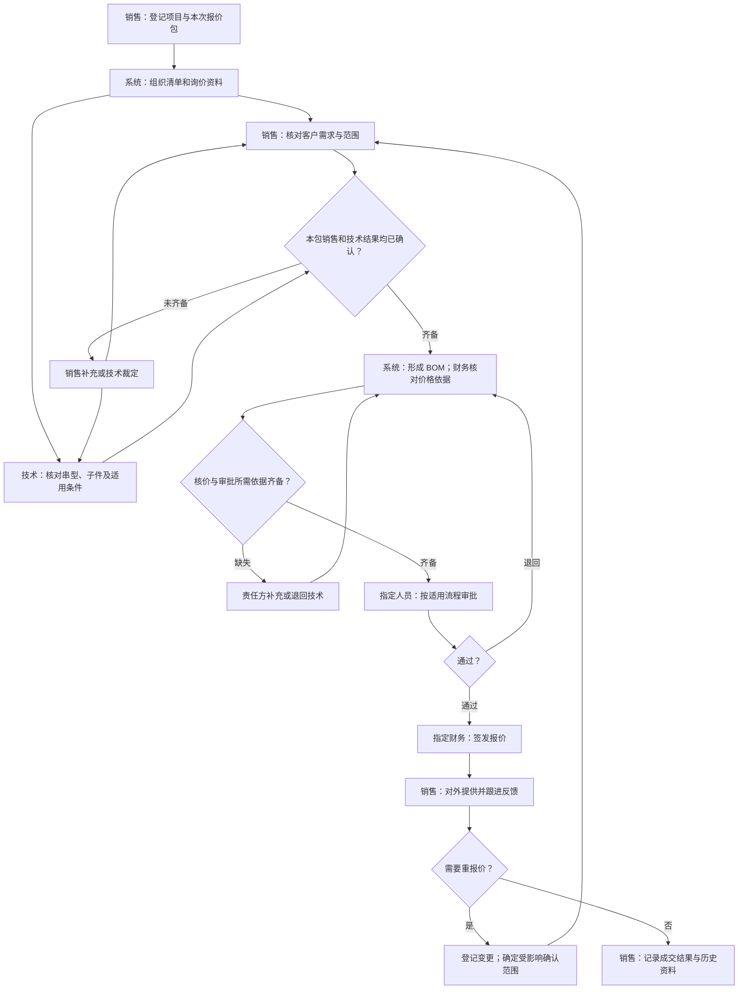

# 红光金具智能报价系统 PRD 初稿

> **这是工作底稿，不是开发基线。** 用途：供 PM、研发与客户逐页确认当前原型的范围与业务流程。
> 状态：评审中；原型尚未正式确认冻结。
> 版本：V0.1；编制日期：2026-10-14。
> 骨架：prd-generation「PRD 初稿版」，独立初稿模板。
> 原型依据：当前工作区源码，读取时 HEAD 为 `c1c61b7`；工作区内容是本稿页面清单的依据。
> 出口：由研发判断是否足以开展对客原型确认（G5）；本次编制不代替研发、PM 或客户签字。

# 0. 本稿依据

本项目围绕国网金具询价，在项目下按报价包组织资料、需求确认、技术选型、BOM、财务核价、审批签发与成交跟进。已有文档提供业务背景和历史确认；当前原型展示最新页面及交互。两者不一致的部分保留为评审问题，不以源码行为自动替代既有业务决定。

## 0.1 输入材料与确认程度

| 输入 | 当前取得的材料 | 确认程度与使用边界 |
|---|---|---|
| 合同 | 既有 PRD 引用合同及分期要求；本次未取得可直接核对的签署合同原件 | 合同编号、签署日期、条款和附件范围待核对；不能把转述当成原件核验完成 |
| 客户定稿方案说明书 | 本次未取得独立、具备客户定稿记录的方案说明书 | 方案版本及其与合同的关系待 PM 补齐 |
| 当前原型 | E01–E03 所指工作区，含 16 个可由应用入口显示的页面 | 用户本轮明确指定当前工作区原型，并确认尚未正式冻结；不声明 G3、G6、G7 已通过 |
| 既有需求文档 | E04，整合版 v1.9，编制日期 2026-09-12 | 既有业务依据；文档写明 Gate 3 待确认，不能视为本次冻结批准 |
| 历史业务确认 | E05–E07 | 仅沿用其明确记录的决定；历史确认不扩展为对当前全部新增交互的批准 |
| 本稿覆盖范围 | 一期报价闭环及与其相关的治理、账号和流程配置页面；另登记二、三期演示入口 | 实际合同纳入范围须逐项核对；原型可见不等于本期承诺 |

## 0.2 材料索引

以下路径均相对项目根目录，可通过链接回看。源码链接用于证明原型行为，不作为新增合同范围的证明。

| 标识 | 材料 | 本稿使用目的 |
|---|---|---|
| E01 | [README](../../../README.md) | 项目定位、能力边界及既有 PRD 入口；部分说明与当前源码的差异见第 6 章 |
| E02 | [应用入口](../../../src/App.vue) | 当前导航、页面名称、包内页签和页面挂载关系 |
| E03 | [业务模型](../../../src/domain/model.ts)、[业务操作](../../../src/domain/store.ts) | 原型业务对象、操作权限、报价与归档行为 |
| E04 | [既有整合 PRD v1.9](../../../docs/正式项目需求文档_红光金具智能报价系统_2026-09-08.md) | 既有范围、角色、流程、分期及 OPEN-01～OPEN-18 |
| E05 | [业务上下文](../../../CONTEXT.md) | 项目、询价包、候选、BOM、双确认及报价快照等术语 |
| E06 | [历史用户决定](../../../docs/pm-run-2026-09-08/evidence/user-decisions.md)、[业务流程评审稿](../../../docs/reviews/业务流程评审稿_2026-09-10.md) | 需求范围、确认职责、客户反馈与尚待确认的口径 |
| E07 | [报价包边界](../../../docs/adr/0001-package-level-quotation.md)、[检索来源治理](../../../docs/adr/0002-governed-retrieval-sources.md)、[混合 BOM 与核价边界](../../../docs/adr/0003-mixed-bom-and-price-boundary.md)、[版本与审批绑定](../../../docs/adr/0004-versioned-approval-and-evidence.md) | 已记录为 Accepted 的历史业务取舍 |
| E08 | [原型归档及批准核验记录](../../../docs/pm-run-2026-09-08/review-final-seal.md) | 区分历史文件核验、业务批准和生产验收 |

## 0.3 阅读约定

- **既有需求有记载**：已有业务文档支持该方向，但合同原件及当前适用性仍需核对。
- **当前原型事实**：源码已表达该页面或行为；本稿不据此承诺生产服务已完成。
- **原型有·依据缺**：未找到与当前具体设计对应的需求确认依据；须经 PM 核定，不能直接进入正式范围。
- **有冲突**：当前原型与既有规则不一致，两边均保留，不自行选择。
- 页面名称以 E02 当前导航为准。“串型检索”在本原型中属于“询价协作”的内嵌串信息/候选区域，不单列成一个导航页面。

# 1. 范围与系统边界

## 1.1 本期范围

下表是基于既有需求整理的**拟核对范围**，不是重新批准合同范围。合同依据列明确区分原件与转述。

| 编号 | 范围项 | 合同依据与当前来源 |
|---|---|---|
| S01 | 项目和报价包两层组织；每包独立询价、核价、审批、签发及跟进 | E04 第 2、4 章，E07 报价包边界；合同原件待核对 |
| S02 | 接收询价资料，按包组织货物项、原始来源和缺失事项 | E04 FR-IN-01～04；合同原件待核对；原型资料解析仍以演示结果为主 |
| S03 | 销售确认需求与范围，技术核对串型和子件，两侧确认后交财务 | E04 FR-WF-01、BR-01，E06；技术员工与总监分工及先后次序见 Q03、Q13 |
| S04 | 支持技术规范编码、串型号组合、附图图册和品名描述补充检索，保留采用依据 | E04 FR-SR-01～05；当前检索在询价协作内嵌区域呈现 |
| S05 | 成套金具串和直接采购单件的 BOM 组织及客户参考结构导出 | E04 FR-BM-01～02，E07 混合 BOM；独立物资的具体确认与生产下单边界待核对 |
| S06 | 关联有效物料与价格依据，财务核价后进入审批签发 | E04 FR-PR-01～02、FR-AP-01～03；当前计价交互有变化，不能直接沿用旧规则，见 Q01、Q09 |
| S07 | 逐人处理适用审批，指定财务签发，销售取得报价并跟进外发和成交 | E04 FR-QT-01～03，E07 版本与审批绑定；当前董事长职责、销售改价和审批阈值见 Q02、Q04、Q05 |
| S08 | 报价历史及重新报价，保存资料和确认依据 | E04 FR-QT-02；当前取消归档和旧快照修改见 Q02、Q07 |
| S09 | 基础资料审核、图册与映射版本、字段字典及同义词治理 | E04 FR-MD-01～03，E07 检索来源治理；原型发布和字典仅部分演示 |
| S10 | 用户、角色、项目范围及审批流程配置 | E04 FR-UM-01 和“审批签发流程台账”；用户、角色页当前只读，配置页面形态和职责见 Q04、Q06、Q12 |

## 1.2 非本期范围

| 排除项 | 原因 | 来源 |
|---|---|---|
| 二期完整单品成本精算、材料价导入及报价比对 | 既有需求将其列为二期；当前页面仅演示该方向 | E04 第 2 章分期，E02 二期入口 |
| 三期完整报告关联、参数化出图及正式工程图交付 | 既有需求将其列为三期，并要求专项确认 | E04 第 2 章分期，E02 三期入口 |
| 南网业务规则直接套用国网规则 | 历史本期边界为国网；原型虽可选择南网，不代表该范围已获确认 | E05、E06 历史 D04、E04 第 6 章；见 Q11 |
| 无拆解依据的非标金具自动完成设计、选型和报价 | 既有文档要求转人工，不允许伪造完整结果 | E04 第 2、6 章 |
| 对 U9/ERP/MES 写入或自动下单 | 既有方向为只读集成；BOM 导出不等于生产订单 | E04 第 9 章，E07 混合 BOM |
| 将演示账号、浏览器保存、样例价格或预置解析结果当作生产能力 | 当前是需求沟通原型 | E01、E03 |

ZIP 是既有需求中的资料接入事项，不能因当前未实现就认定为合同排除。历史 D03 仅允许当轮不检查 ZIP；当前交付安排继续见 OPEN-08。

## 1.3 系统边界

| 系统 / 能力 | 本项目是否建设 | 本系统职责 | 原型现状与确认边界 |
|---|---|---|---|
| 金具报价工作台 | 既有需求有记载 | 组织报价包、协作、BOM、核价、审批和跟进 | 当前是浏览器交互原型；正式范围待合同核对 |
| 通用资料解析服务 | 既有材料称复用 | 接收解析结果，并按国网项目组织来源与货物项 | 当前包资料处理生成演示结果；历史“多文件混析已完成”不等于当前原型已接入 |
| 项目物料清单读取 | 当前原型事实，具体入口待确认 | 从 XLSX 整理包和数量分布，帮助建立项目台账 | 已存在本地文件读取代码；与后续招标附件解析为两条能力，不混称 |
| 图册、标准串及物料来源 | 既有需求有记载 | 使用审核过的资料参与检索并保留引用 | 当前为节选与样例；全量、页码定位和真实图册拆解待确认 |
| U9/ERP/MES | 外部系统，本项目不替代建设 | 只读关联物料和价格依据 | 当前模拟带价；真实字段含义、权限和同步规则见 OPEN-05 |
| 报价与 BOM 文件输出 | 既有需求有记载 | 按授权输出本包清单及报价 | 当前源码已有 BOM XLSX 和报价 XLSX；正式模板、签章和 PDF 待确认 |
| 账号与权限 | 既有需求有记载 | 约束角色、实际责任人和项目数据范围 | 原型可切换身份，用户及角色页为只读展示；生产认证未接入 |
| 客户沟通与外发 | 销售业务动作 | 登记报价对外提供及跟进结果 | 下载不等于客户已收到；原型未证明自动发送或客户收件能力 |

## 1.4 外部责任与依赖（契约视角登记）

本次缺少签署合同、协议及其附件原件，无法建立有明确契约依据的外部责任表。既有文档记录了客户资料、U9、部署和模板等待提供事项，其责任分配作为第 6 章的核对线索，不认定已落实，不编造交付时间。

# 2. 用户与角色

| 用户 / 角色 | 主要职责 | 主要使用页面 / 能力 |
|---|---|---|
| 销售 | 建立项目与报价包，收集资料和客户条件，确认需求范围，外发及跟进成交 | 工作台、项目台账、报价包列表、资料解析、询价协作、BOM、报价记录、历史库 |
| 技术 | 核对适用条件、串型和子件，裁定技术差异并完成技术确认 | 询价协作及内嵌选型区域、BOM、资料治理、规则与字典 |
| 技术总监 / 技术员工 | 当前原型进一步区分指派、处理、提交和总监确认 | 询价协作；这两个岗位不是新增顶层角色，正式分工待确认 Q03 |
| 财务 | 核对有效成本依据，形成报价，处理分配给自己的审批或签发任务 | 工作台、核价与审批、报价记录、BOM、历史库 |
| 董事长 | 既有需求赋予审批及方案调整职责；当前原型偏向全包监看与配置，差异待确认 | 核价与审批、审批与流程配置；可见范围和业务操作见 Q04 |
| 管理员 | 按批准制度维护账号、角色和流程配置 | 用户管理、角色管理、审批与流程配置；不能因管理员身份自动获得业务审批权。用户于 2026-10-14 确认将原型三个演示管理员合并为一个“管理员”；这不代表内部 IT 的独立业务职责已被合并或批准 |
| 红光内部 IT | 既有需求记载维护 U9 料号映射、同步及接口运行 | 当前没有独立 IT 角色入口；正式入口与管理员职责区分见 Q12 |

## 2.1 权限原则（粗粒度）

| 角色 | 可见范围 | 可操作范围 | 待确认点 |
|---|---|---|---|
| 销售 | 所负责项目及报价包；内部成本、毛利不可见 | 需求范围和外发跟进 | 已签发报价价格是否允许销售修改，见 Q02 |
| 技术 | 所负责技术资料；内部成本和最终报价金额不可见 | 选型、技术核对及技术确认 | 员工与总监最终权限、销售确认之前能否开展技术工作 |
| 财务 | 授权报价包的核价、报价与审批材料 | 核价及分配给自己的审批/签发 | 行级与整包计价、代办授权、正式账号对应关系 |
| 董事长 | 既有文档为授权项目，当前原型为全部项目和包 | 当前原型监看和阈值配置；正式审批职责有冲突 | 只读还是可审批/调价；可见全部项目是否获授权 |
| 管理员 | 必要系统配置与审计；当前角色页另写全部数据 | 按批准记录配置系统 | “全部数据”的含义，是否包含内部价格与业务材料 |
| 红光内部 IT | U9 映射与接口运行必要资料 | 外部映射和同步维护 | 身份、页面及职责是否独立配置 |

同角色不等于同权限。当前原型已有指定人员处理业务的交互；生产授权仍需服务端落实。初稿不定义页面级权限矩阵，也不把顶部角色切换当成身份认证。

# 3. 核心业务场景与主流程

## 3.1 核心场景清单

主业务单位是**报价包**；项目是其上层台账。一个包的已签发报价与后续重报价应可追溯。技术候选是待确认对象，不能因系统召回而直接成为正式选型。

| 编号 | 场景名称 | 参与方 | 触发条件 | 结束条件 | 对应页面（初步） |
|---|---|---|---|---|---|
| C01 | 建立项目、报价包并整理询价资料 | 销售、系统 | 收到客户询价及货物清单 | 本次报价包和待核对货物项可供协作 | 项目台账、报价包列表、资料解析 |
| C02 | 完成客户需求与技术选型确认 | 销售、技术、系统 | 本包有可核对的资料与货物项 | 销售与技术分别完成当前有效结果确认，未决技术事项有明确处置 | 询价协作 |
| C03 | 形成 BOM 并完成核价 | 技术、财务、内部 IT、系统 | 当前销售及技术结果具备交接条件 | 财务获得可提交审批的报价依据 | BOM、核价与审批 |
| C04 | 完成审批并签发报价 | 指定审批人、指定财务、系统 | 报价依据保存并提交 | 当前报价获有效审批并由指定人员签发 | 核价与审批、报价记录 |
| C05 | 外发、议价及成交跟进 | 销售、客户、财务 | 已取得签发报价 | 形成成交结果或进入明确的重报价流程 | 报价记录、历史库 |
| C06 | 处理退回与重报价 | 销售、技术、财务、系统 | 需求、选型、商务或客户反馈变化 | 受影响结果重新确认后进入后续报价环节 | 询价协作、BOM、核价与审批、报价记录 |
| C07 | 治理检索资料并提供可引用版本 | 技术、内部 IT、管理员、系统 | 收到新图册、映射或字典资料 | 相关资料经审核后成为可使用的来源，旧引用可回看 | 资料治理、规则与字典 |

工作台汇总待办；账号、角色与流程配置支撑这些场景，不另拆成“点击菜单”等核心场景。

## 3.2 主流程草图

本图表示待对客确认的业务主线，不是详细状态机。箭头表达职责交接，不决定销售与技术工作的全部并行次序。

## 3.3 C01：建立项目、报价包并整理询价资料

| 项 | 内容 |
|---|---|
| 场景目标 | 将客户询价资料组织到正确项目与包，便于后续逐项核对 |
| 参与方 | 销售、资料处理能力 |
| 触发与前置条件 | 收到本次货物清单或询价文件，明确报价包归属 |
| 主流程 | 登记项目 → 当前原型读取项目物料清单并创建包 → 销售进入本包补充询价资料 → 组织货物项及需确认事项 |
| 结束条件 | 本次包可进入询价协作，原始资料及缺项能回看 |
| 待与客户确认 | 是否必须上传 XLSX 才能新建项目；按清单自动生成包还是手工建包；电压放在项目、包还是货物项；真实解析服务与当前清单读取如何交接 |

## 3.4 C02：完成客户需求与技术选型确认

| 项 | 内容 |
|---|---|
| 场景目标 | 把候选结果与待补信息核定为本包有效需求和技术结果 |
| 参与方 | 销售、技术；原型区分技术员工与技术总监 |
| 触发与前置条件 | 本包有货物项及资料来源 |
| 主流程 | 销售核对范围并补客户条件 → 技术查看串及子件，核对候选和依据 → 必要时销售补充或技术退回 → 两侧分别完成确认 |
| 结束条件 | 可以向 BOM 和核价交接；未确认候选不得冒充正式技术结果 |
| 待与客户确认 | 旧需求允许并行，原型总监/员工提交路径依赖销售先确认；员工是否可独立完成最终确认；新子件选型与参考子件替代能力的正式范围 |

## 3.5 C03：形成 BOM 并完成核价

| 项 | 内容 |
|---|---|
| 场景目标 | 从确认后的串及单件形成物料清单与报价依据 |
| 参与方 | 技术、财务、红光内部 IT |
| 触发与前置条件 | 当前有效销售与技术确认完成，必要技术事项已处理 |
| 主流程 | 组织 BOM → 关联物料与价格资料 → 财务核对缺失依据 → 形成并保存报价 → 交适用审批 |
| 结束条件 | 本包报价及对应依据可交给审批人员 |
| 待与客户确认 | 初稿不裁定当前单项毛利率与旧整包方案冲突；参考子件、历史价格和财务手填价格是否为正式可用来源；BOM 草稿与生产下单文件的区别 |

## 3.6 C04：完成审批并签发报价

| 项 | 内容 |
|---|---|
| 场景目标 | 按明确的审批职责出具可对外使用的本包报价 |
| 参与方 | 指定财务审批人、指定签发人；董事长职责待 Q04 裁定 |
| 触发与前置条件 | 有保存的核价依据和可用流程 |
| 主流程 | 提交本包审批 → 当前责任人逐步处理 → 不通过则财务补充或调整 → 所需处理完成 → 指定财务签发 |
| 结束条件 | 本次签发记录与报价可回看，销售可以取得获准对外提供的版本 |
| 待与客户确认 | 董事长是否为审批节点；金额/毛利阈值仅提醒还是决定节点；流程在建包还是提交时绑定；在办包能否变更审批人 |

## 3.7 C05：外发、议价及成交跟进

| 项 | 内容 |
|---|---|
| 场景目标 | 将已签发报价提供客户并保存跟进结果 |
| 参与方 | 销售、客户；涉及改价时需明确财务及审批职责 |
| 触发与前置条件 | 本包有已签发报价 |
| 主流程 | 销售查看并下载本次报价 → 对外提供并登记 → 跟进反馈 → 记录成交、未成交或取消 → 保留历史资料 |
| 结束条件 | 本包结果与对应报价有据可查，或明确进入下一轮报价 |
| 待与客户确认 | 销售是否可改已签发价格；正式外发记录需证明什么；归档之后谁能重开；直接修改和重新签发如何区分 |

## 3.8 C06：处理退回与重报价

| 项 | 内容 |
|---|---|
| 场景目标 | 变更后重新取得相应确认，不混用旧报价与新依据 |
| 参与方 | 销售、技术、财务、审批人员 |
| 触发与前置条件 | 存在需求变化、技术退回、核价退回或客户议价 |
| 主流程 | 登记原因和变化内容 → 确定受影响范围 → 责任角色重新处理 → 有效确认与报价依据齐备后再审批签发 |
| 结束条件 | 后续报价能追溯到相应需求、技术与审批依据，历史结果能回看 |
| 待与客户确认 | 原型有整包确认失效与阶段退回；旧需求按受影响项区分数量、价格和技术变化，具体保留范围待核对 |

## 3.9 C07：治理检索资料并提供可引用版本

| 项 | 内容 |
|---|---|
| 场景目标 | 让后续报价使用可审核、可追溯的图册和物料资料 |
| 参与方 | 技术、红光内部 IT、管理员 |
| 触发与前置条件 | 有新增图册、映射或待核对的基础资料 |
| 主流程 | 接收资料 → 拆解或比对 → 人员核对差异 → 审核发布 → 新检索引用有效资料 |
| 结束条件 | 有可使用的来源，已报价项目仍能回看原引用 |
| 待与客户确认 | 原型治理页面仅模拟部分发布动作；图册来源索引、IT 映射入口及字典维护职责需逐页确认 |

## 3.10 跨场景的争议点

| 争议点 | 既有文档的说法 | 当前原型的说法 | 现状 |
|---|---|---|---|
| 核价方式 | 整包毛利率与三档报价方案 | 财务逐货物项设置毛利率 | 有冲突，Q01 |
| 已签发价格 | 财务签发冻结；销售对外提供；调整需新版本 | 销售可直接调整最新已签发报价，修改原快照 | 有冲突，Q02 |
| 董事长职责 | 条件审批及方案调整 | 核价页以只读监看为主，业务操作限制为财务节点 | 有冲突，Q04 |
| 阈值与审批 | 达到条件触发审批/升级 | 阈值仅风险提醒，不增加节点 | 有冲突，Q05 |
| 流程绑定 | 提交审批时绑定当时启用流程 | 建包复制流程，提交可使用包已有快照；编辑可改待处理人员 | 有冲突，Q06 |
| 技术处理次序 | 销售技术可并行 | 当前技术提交与总监确认依赖销售确认 | 有冲突，Q03、Q13 |
| 归档 | 历史只读，后续报价以新版本继续 | 销售可取消归档，包回到议价 | 有冲突或未覆盖细化，Q07 |

# 4. 页面清单（初步）

共 **16 个当前挂载页面**。内嵌面板、抽屉、弹窗及步骤条归所属页面，不重复计数。只存在组件文件、未从当前应用入口挂载的画布设计组件不视为独立页面。

| 模块 | 页面 | 页面目标（初稿） | 主要用户 | 依据来源 | 备注 |
|---|---|---|---|---|---|
| 工作台 | 工作台 | 汇总本人待办和包进度，进入待处理业务 | 销售、技术、财务、董事长 | E02；DashboardView、DashboardInsights | 既有需求有工作台方向；具体统计和全局可见范围待确认 |
| 报价项目 | 项目台账 | 登记并查找项目，进入所属报价包 | 销售及授权人员 | E04 第 4 章；OverviewView、NewInquiryDialog | XLSX 必须上传和自动建包的具体方式为原型有·依据缺，Q08 |
| 报价项目 | 报价包列表 | 查看一个项目下各包进度、清单汇总和负责事项 | 销售及本包责任人员 | E07 报价包边界；PackageListView | 当前按人员和业务阶段计算可见包；合同与客户授权需核对 |
| 包内流程 | 资料解析 | 登记本包询价资料，发起处理并查看结果 | 负责销售，相关人员查看 | E04 FR-IN-01～04；SourcesView、ParseRunPanel | 本包解析使用演示结果；真实项目清单读取是另一入口，不混淆 |
| 包内流程 | 询价协作 | 核对客户货物项、串型、子件和来源，完成销售及技术确认 | 销售、技术 | E04 FR-WF、FR-SR；CollaborationView | 检索及子件编辑内嵌于此；员工/总监分工、新参考子件能力为原型有·依据缺，Q03、Q09 |
| 包内流程 | BOM | 汇总确认的串及子件，查看并导出本包物料清单 | 销售、技术、财务及获授权人员 | E04 FR-BM-01～02；BomView、bom-export | 支持独立页面和协作页内嵌展示；董事长可见性与旧矩阵需核对 |
| 包内流程 | 核价与审批 | 财务补齐报价依据，提交审批；责任人处理审批或签发 | 财务；董事长监看范围待确认 | E04 FR-PR、FR-AP；FinanceView、ApprovalTasks | 逐货物项毛利率、参考成本、董事长只读与旧需求有差异，Q01、Q04、Q09 |
| 包内流程 | 报价记录 | 查看签发报价、下载、登记外发、跟进与重报价 | 销售、财务、董事长 | E04 FR-QT；QuotesView、quote-export | 当前可导出 XLSX；销售编辑签发价格有冲突 Q02 |
| 资产与规则 | 资料治理 | 管理 U9 辅助来源及图册资料的接收、审核和发布 | 技术、内部 IT 与管理员职责待核对 | E04 FR-MD-03；DataGovernanceView | 仅模拟部分治理动作；技术/IT 管理权限待确认 |
| 资产与规则 | 历史库 | 查阅成交、未成交、取消的包及相应报价/BOM | 授权销售、技术、财务及管理人员 | E07 报价包边界；ArchiveView | 跨项目数据范围、取消归档及归档细化为原型有·依据缺，Q07、Q12 |
| 资产与规则 | 规则与字典 | 查看业务字段、同义词及必填口径 | 业务与治理人员 | E04 FR-MD-01～02；RulesView | 当前只读展示；不代表审核发布和维护功能完成 |
| 系统管理 | 用户管理 | 查看系统人员、角色和范围，确定正式账号管理入口 | 管理员 | E04 FR-UM-01；UserManagementView | 当前只读，新增和编辑入口禁用；生产账号能力仍缺 |
| 系统管理 | 角色管理 | 查看各角色操作和数据可见性 | 管理员及获授权查看者 | E04 第 3 章；RoleManagementView | 当前只读；矩阵与旧规则存在差异，不能当作服务端授权已完成 |
| 系统管理 | 审批与流程配置 | 配置默认负责人、审批参与人及报价提醒参数 | 董事长、管理员；其他人员查看范围待确认 | E04 审批流程方向；ApprovalWorkflowView、workflow store | 旧文档描述流程台账与画布；当前是配置模板，页面形态为原型有·依据缺，Q05、Q06 |
| 后续阶段 | 成本库与集成 | 演示二期成本核算及集成方向 | 财务、技术及评审人员 | E04 二期范围；PhaseView（phase2） | 菜单名“成本库与集成”，页内标题“成本库与集成深化”；仅二期演示，不纳入一期完成承诺 |
| 后续阶段 | 报告与出图 | 演示三期报告关联与出图方向 | 技术及评审人员 | E04 三期范围；PhaseView（phase3） | 菜单名“报告与出图”，页内标题“报告关联与三维出图”；仅三期演示 |

上述组件均位于 `src/components/`；导出文件位于 `src/lib/`，规则和业务操作位于 `src/domain/`。下表只登记内嵌区域，用于逐页确认时防止遗漏，不增加页面数。

| 所属页面 | 内嵌区域 / 对话框 | 确认重点 |
|---|---|---|
| 项目台账、报价包列表 | 新建/编辑项目与包、物料清单导入、流程参与人 | 清单建包、包级条件、负责人选择是否符合实际业务 |
| 询价协作 | 串信息与来源、候选比较、子件信息及选型、参考子件、技术指派与退回、内嵌 BOM | 采用依据、技术最终确认职责、范围变更与替代子件边界 |
| 核价与审批 | 子件成本来源、参考成本说明、审批任务及退回 | 价格来源、财务核对责任、董事长职责与审批依据 |
| 报价记录、历史库 | 报价预览、成交登记、归档详情与导出 | 签发后可修改范围、历史只读和外发依据 |
| 包内流程公共区 | 当前项目/包、流程进度、流程记录 | 查看的是哪个包和哪轮报价，指定人员及历史意见是否一致 |

## 4.1 无前端页面的系统级能力

| 能力 | 说明 | 触发 / 生效时机 | 备注 |
|---|---|---|---|
| 资料解析及包归属组织 | 提取资料并建立货物项、文件关系和来源 | 销售发起本包处理 | 原型未接真实解析；历史服务状态需联调核实 |
| 检索与来源引用 | 根据货物项条件召回候选并保留依据 | 技术查看和核对候选 | 当前节选数据不证明全量覆盖 |
| 物料与价格关联 | 提供有效映射及核价所需资料 | 技术确认后及财务核价时 | U9 字段含义、更新和正式参考价规则待确认 |
| 确认与报价依据关联 | 使报价引用正确需求、技术和核价资料 | 变更、审批、签发及重报价 | 细化规则有原型/旧文档差异，见 Q02、Q06、Q13 |
| 文件生成 | 输出本包 BOM 和报价 | 获授权人员下载 | 当前 XLSX 可生成；生产模板和签章未确认 |
| 业务记录与身份授权 | 记录人员操作，按实际账号与项目授权限制业务 | 业务处理和查看 | 原型本地记录和角色切换不替代服务端实现 |

# 5. 本稿缺口清单

| 缺口 | 缺什么 | 为什么现在补不了 | 何时由谁补 |
|---|---|---|---|
| 合同与附件依据 | 签署原件、条款、明确交付清单、引用方案版本 | 当前只有既有需求转述，不能确认每个新增交互都属合同 | PM 在对客范围确认前核对 |
| 方案定稿依据 | 客户确认的方案说明书及版本 | 工作区未提供独立客户定稿记录 | PM 提供并核对合同关联 |
| 原型逐页确认 | 当前 16 页及内嵌区域的客户反馈和冻结记录 | 用户已明确尚未正式冻结 | 研发协同 PM、客户完成逐页确认后形成记录 |
| 原型与旧 PRD 差异 | Q01～Q14 所涉正式业务取舍 | 当前没有覆盖这些变化的明确新裁定 | PM 组织对应客户角色确认，不由 AI 猜定 |
| 生产人员与权限 | 正式账号、责任人、项目数据范围、代办和 IT 角色 | 原型使用演示人员及前端切换 | 客户负责人与 IT 在账号设计前确认 |
| 全量业务资料 | 完整图册、真实物料/U9 数据、端到端样例 | 当前数据为节选，已提供资料的处理结果仍需核对 | 客户技术、销售、IT 及财务提供并复核 |
| 正式解析能力 | 多文件混析业务适配、包归属、ZIP 等接入结果 | 当前包资料处理是演示；历史服务完成不等于原型接入 | 研发与客户资料负责人逐项核实 |
| 正式核价口径 | 生效价格来源、财务政策、税和精度、调价授权 | 既有 OPEN 项未关闭；当前计价方式另有变化 | 客户财务、董事长及技术完成业务确认 |
| 正式交付输出 | 最终报价/签章模板、BOM 可下单条件 | 参考导出结构及本地 XLSX 不能代替客户模板批准 | 客户销售、技术、财务确认 |
| 开发与验收详细规格 | 页面字段、操作校验、状态机、逐页验收 | 初稿阶段按 skill 不展开；原型未定 | 当前原型冻结后按最终原型重新生成完整稿 |

# 6. 待确认事项

## 6.0 当前原型需优先确认的问题

“是否阻塞对客确认”指是否妨碍把该事项当作确定规则对客户陈述。标“局部是”的问题可以带着两种口径开展评审，但不能先宣称其中一种已经正式批准。责任方是建议确认对象，具体具名负责人仍待 PM 指定。

| 问题 | 来源 | 影响页面 / 功能 | 当前已知 | 未明确 | 是否阻塞对客确认 | 责任方 | 状态 |
|---|---|---|---|---|---|---|---|
| Q01 核价按整包还是逐项毛利率 | E04 BR-10；FinanceView、store 的 savePrice | 核价与审批、报价记录 | 旧规则是整包三档方案；原型逐货物项编辑毛利率 | 本轮是否批准改为逐项；三档方案是否保留及如何组织 | 局部是 | PM、客户财务 | 有冲突 |
| Q02 销售可否修改已签发报价 | E04 BR-05、FR-QT-02；E07；QuotesView、store 的 updateQuotePrices | 报价记录、导出、审批依据 | 原型直接修改最新已签发快照价格和总额，不重新签发 | 是否允许；是否需新版本、财务复核和审批；旧对外文件如何追踪 | 局部是 | PM、客户财务/销售/董事长 | 有冲突 |
| Q03 技术总监与员工分工 | E04 技术职责；CollaborationView | 询价协作、待办、人员配置 | 原型有总监指派、员工提交、总监确认或退回 | 是否真实岗位制度，哪些人可最终确认，代理/缺岗如何处理 | 局部是 | PM、客户技术负责人 | 原型有·依据缺 |
| Q04 董事长是否审批或调价 | E04 FR-AP-03；FinanceView、RoleManagementView、store | 核价与审批、全包监看、角色管理 | 旧需求含审批和方案调整；当前原型董事长主要只读，调整动作明确拒绝 | 是否取消审批/调整职责；全项目查看权限是否获授权 | 局部是 | PM、董事长、财务 | 有冲突 |
| Q05 阈值提醒还是流程分流 | E04 FR-AP-01；ApprovalWorkflowView、store 的 settings | 审批与流程配置、核价与审批 | 原型阈值只提醒，不增加节点、不改变在办审批状态 | 正式是否保留条件审批；未配置制度时如何处理 | 局部是 | 董事长、财务、PM | 有冲突 |
| Q06 流程配置、绑定与在办变更 | E04 审批台账；App、ApprovalWorkflowView、store 的 newPackage/editPackage/approveFinance | 审批与流程配置、建包、审批 | 原型为模板配置；建包可保留流程快照，编辑可改未处理节点人员；旧文档为提交时绑定且台账/画布管理 | 以哪一版为准；编辑权限、绑定时间、人员替换、旧流程维护入口 | 局部是 | PM、财务、管理员 | 有冲突 |
| Q07 归档之后能否重开 | E07 历史边界；ArchiveView、store 的 unarchive | 历史库、报价记录 | 原型销售可取消归档，成交结论回到议价 | 哪些结果允许撤回；是否需授权/复核；原成交依据如何保留 | 局部是 | PM、客户销售/财务 | 需补确认依据 |
| Q08 项目建包与电压层级 | E04 第 4 章；NewInquiryDialog、material-list、store | 项目台账、报价包列表 | 原型新项目要求 XLSX，读取后自动建包；电压已放包及货物项，旧规则记在项目 | 是否必须清单建项目；如何处理空清单/未知格式；电压业务层级 | 局部是 | PM、客户销售/技术 | 具体设计依据缺；部分有冲突 |
| Q09 参考子件及价格来源 | E07 一期核价；PartReferencePicker、part-reference、FinanceView | 子件选型、BOM、核价与审批 | 原型有参考子件、历史/维护库价、财务手填及参考成本演示 | 替代是否允许；技术批准与财务价格确认如何分工；参考成本是否符合一期价格边界 | 局部是 | PM、客户技术/财务 | 原型有·依据缺 |
| Q10 当前真实与模拟能力 | E01；NewInquiryDialog、material-list、SourcesView、quote-export | 项目导入、资料解析、导出 | 新项目清单已本地读取；包解析仍模拟；报价已有 XLSX；README 对解析/报价导出仍有较旧说明 | 现场演示和交付口径如何同步，真实解析和正式模板的完成证据 | 否；不得宣称生产完成 | PM、研发 | 待核对说明 |
| Q11 南网入口是否保留 | E05、E06 D04；NewInquiryDialog | 项目台账、检索规则 | 原型可以选择南网，历史本期范围为国网 | 属演示选择、后续阶段还是新增需求；不得套用国网规则 | 局部是 | PM、客户业务负责人 | 原型有·依据缺 |
| Q12 账号、IT 与数据可见范围 | E04 第 3 章；UserManagementView、RoleManagementView、ArchiveView | 用户/角色管理、历史库、资料治理 | 用户/角色页只读，IT 无独立角色入口；董事长/管理员全局范围与旧矩阵存在差异 | 实际账号和项目范围、管理员价格访问、IT 独立职责、跨项目归档权限 | 局部是 | PM、客户负责人/IT | 待确认；部分有冲突 |
| Q13 并行确认与变更重审 | E04 第 4 章；CollaborationView、model/store | 询价协作、退回、重报价 | 旧规则并行及按受影响项保留确认；原型部分技术提交依赖销售先确认，部分变更使整包确认失效 | 哪些步骤能并行；数量/价格/技术变化分别重做什么 | 局部是 | PM、客户技术/销售/财务 | 有冲突 |
| Q14 功能指标和二三期边界 | E04 分期及 OPEN 项；PhaseView | 后续阶段、合同范围 | 二三期为演示，不是生产完成；既有指标及样本仍待确认 | 当前合同引用方案、指标分母、二三期内容和正式批准版本 | 否；分期不得混入一期 | PM、客户项目负责人 | 待合同核对 |

## 6.1 超合同范围的诉求（不在正文，登记待变更）

本轮用户仅要求根据当前原型生成初稿，没有提出新增业务诉求。因合同原件缺失，不能把下列已有原型设计直接断言为“超合同”；先作为**可能新增、需 PM 核对**登记。范围未确认前，不作为正式交付承诺。

| 诉求 / 需核对设计 | 提出方 | 原型中是否已有 | 影响范围 | 处置 |
|---|---|---|---|---|
| 销售直接编辑已签发价格 | 当前原型，未找到对应新确认 | 是 | 签发、审批、历史报价及对外文件 | 关联 Q02，核对合同和业务批准；不得默认生效 |
| 技术员工提交与总监复核 | 当前原型，未找到对应新确认 | 是 | 岗位、待办、权限及流程交接 | 关联 Q03，确认属于细化还是范围变更 |
| 参考子件替代与参考成本 | 当前原型，未找到对应新确认 | 是 | 技术选型、核价、价格依据 | 关联 Q09，先确认业务边界 |
| XLSX 强制项目创建与自动建包 | 当前原型，未找到对应新确认 | 是 | 项目创建及清单处理 | 关联 Q08，核对是否现有资料接入范围的已批准细化 |
| 南网业务入口 | 当前原型，历史一期限定国网 | 是 | 电网范围与检索资料 | 关联 Q11，确认仅演示/后续或正式变更 |
| 取消归档及全局查看权限 | 当前原型，未找到完整授权依据 | 是 | 历史结果、角色和数据范围 | 关联 Q07、Q12，经责任人确认后再纳入正式规格 |

## 6.2 依据缺失

| 缺哪份依据 | 影响的判断 | 需要谁提供 |
|---|---|---|
| 签署合同及全部有效附件 | 本期范围、外部责任、分期及验收承诺 | PM / 合同范围确认人 |
| 合同引用的客户定稿方案版本 | 固定模块与具体交付清单，关联 OPEN-17 | PM / 客户项目负责人 |
| 当前原型逐页确认及冻结记录 | 是否可生成基于最终原型的完整稿 | 研发、PM、客户 |
| 新增或修订业务规则的批准记录 | Q01～Q14 中原型变化是否正式生效 | PM 与对应业务责任人 |
| 正式账号和岗位授权制度 | 指定处理人、总监/员工、IT 与管理员职责 | 客户负责人 / IT |
| 正式价格、审批制度与签章模板 | 核价、审批、改价和报价文件的正式口径 | 客户财务、董事长、销售 |

## 6.3 沿用的生产待确认事项

E04 的 OPEN-01～OPEN-18 继续保留，原编号不重排。本稿没有获得关闭这些事项的新证据。它们不自动阻塞开展原型评审，但对应生产规则不能提前宣称已确认；Q 项只补充当前原型差异，不替代旧 OPEN 项。

| 编号 | 待确认主题 | 原记录确认责任 | 本稿处理 |
|---|---|---|---|
| OPEN-01 | 金额边界和特殊商务制度 | 董事长/财务 | 与 Q05 联合核对 |
| OPEN-02 | 毛利率底线与利润例外 | 董事长/财务 | 与 Q01、Q05 联合核对 |
| OPEN-03 | 税、币种、精度、舍入、尾差与有效期 | 财务/销售 | 保留；初稿不展开金额规则 |
| OPEN-04 | 账号、项目归属、实际审批人及代办 | 客户负责人/IT | 与 Q03、Q06、Q12 联合核对 |
| OPEN-05 | U9 字段、价格含义、单位、含税属性及权限 | 客户 IT/财务/技术 | 与 Q09 联合核对 |
| OPEN-06 | 完整标准串和缺失物料资料 | 技术/供应 | 节选数据不代表已关闭 |
| OPEN-07 | 已提供图册的历史图号映射与页码索引 | 技术 | 已提供原件不等于索引验证完成 |
| OPEN-08 | 多文件混析国网适配及 ZIP | 研发负责人 | 当前原型未接入；不将历史“不检查 ZIP”解释成永久排除 |
| OPEN-09 | 变更重审、版本管理、政策与项目结案 | 客户业务/财务负责人 | 与 Q02、Q06、Q07、Q13 联合核对 |
| OPEN-10 | 报价签章模板及 BOM 生产下单条件 | 销售/技术/财务 | 本地 XLSX 生成不等于正式模板验收 |
| OPEN-11 | 指标样本、分母、阶段关系和并发口径 | 双方验收负责人 | 保留；不新增性能数值 |
| OPEN-12 | 三期 POC 样本、许可证与环境 | 技术/IT/研发 | 后续阶段演示不关闭此项 |
| OPEN-13 | 完整端到端项目样例 | 客户技术/销售 | 样例需与实际包、资料和结果对应 |
| OPEN-14 | 二期成本样例及财务口径 | 客户财务 | 仍属二期确认 |
| OPEN-15 | 正式内网运行环境 | 客户 IT | 原型本地运行不代替部署确认 |
| OPEN-16 | 甲方人员、历史样本与模板完备性 | 客户项目负责人 | 需核对合同责任及实际提供情况 |
| OPEN-17 | 合同所引方案的版本与确认状态 | 合同范围确认人 | 合同原件及方案缺失，继续保留 |
| OPEN-18 | 地域耐寒分类及冲突处理 | 客户技术/业务负责人 | 不依据地区名称自行推定技术分类 |

# 本稿不做的事（交接时也要讲清）

| 不做 | 原因 |
|---|---|
| 不写逐页字段、按钮、校验、状态机 | 当前原型尚未定稿，留到逐页确认后 |
| 不写逐页验收标准、测试脚本或接口契约 | 初稿用于对原型，不能直接成为开发或验收基线 |
| 不写完整稿的依赖、假设、内部风险及版本规划台账 | 初稿只登记契约依据是否取得及需确认事项 |
| 不给本系统建设成本或商业报价 | 本稿只说明业务范围和流程，不进行商务测算 |
| 不运行 Gate A–I 或宣称通过 G5 | 初稿不跑完整稿门禁；G5 由研发判断并确认 |
| 不标已冻结、不覆盖既有 PRD | 当前新稿保存在工作目录，保留已有需求依据和历史批准 |
| 不把未实现能力、示例人员、价格或样例结果当成生产完成 | 原型与正式系统的能力和证据分别说明 |
| 不自动启动 the-fool 或 the-jury | 本轮只生成初稿；后续评审以本稿和原始材料作为输入 |

原型逐页确认并形成正式最终版后，应重新运行 prd-generation，按最终原型和合同生成完整稿，而不是直接补全本初稿。
