# 红光金具智能报价系统客户使用说明书

原型演示版 V1.4 · 2026年10月15日

## 1 认识工作台和切换操作身份

打开提供给您的原型访问地址。左侧是功能导航，顶部右侧是角色与人员切换入口，主区域展示当前页面。首次使用请从“项目台账”开始；已有项目可从工作台待办或项目进度进入。

先选择角色，再选择当前人员。销售负责创建项目、需求确认、外发和跟进；技术负责串型与子件；财务负责成本核算及审批签发；董事长查看经营与报价情况；管理员维护用户、权限和流程。

切换角色不会自动把任务转交给您。出现“无权访问”或按钮不可用时，请核对页面提示的指定负责人，再在顶部切换到该人员。截图中的项目、金额和人员均为演示示例。

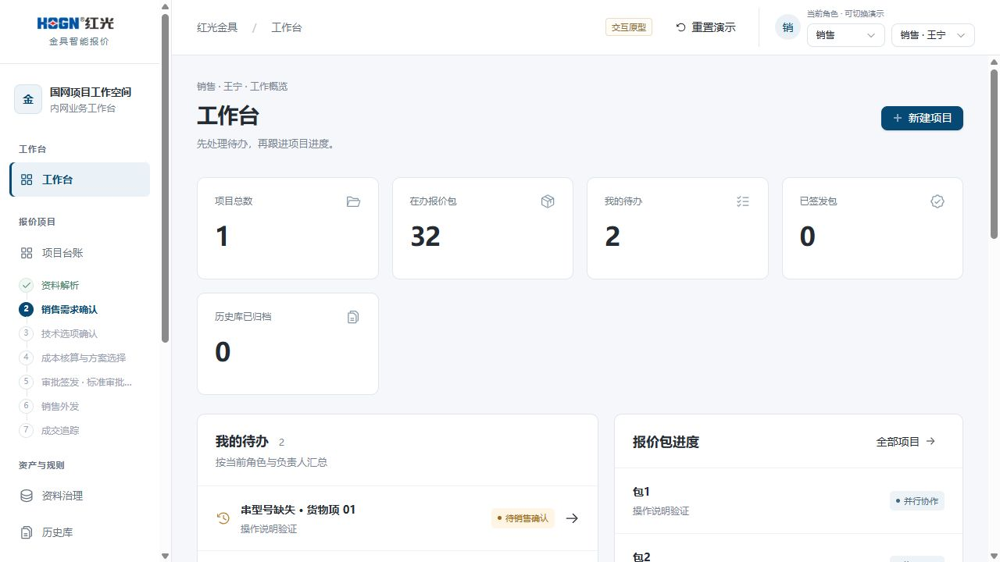

## 2 创建项目并选择负责人

切换到销售角色，点击“项目台账”或工作台中的“新建项目”。填写项目名称，补充客户单位、地区并选择电网类型。

在“项目负责人”中选择销售负责人、技术负责人（总监）和财务负责人。项目创建时就确定操作人员，用户管理中不再进行项目分配。

点击“载入演示文档”。系统读取内置的《一般线路金具与防舞金具货物清单》，展示32个报价包及汇总信息。核对后点击“创建项目”，再点击“查看报价包”。

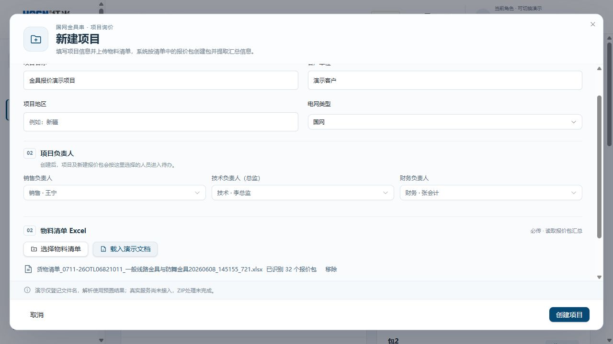

## 3 从项目进入具体报价包

在项目台账点击项目名称或“进入”，查看本项目的报价包列表。可搜索报价包，并按阶段筛选；列表展示电压等级、技术编码种类数、货物总数量和地域分布。

首次体验建议点击“包1”或该行“进入”。项目物料清单已自动带入各报价包，进入新包后从资料解析开始。

物料清单可识别32个包；现有技术资料覆盖包1、2、3、4、6、8、11、12、20、21、25、29。其他包暂未提供对应演示技术资料，页面会提示，体验时请选择上述报价包。

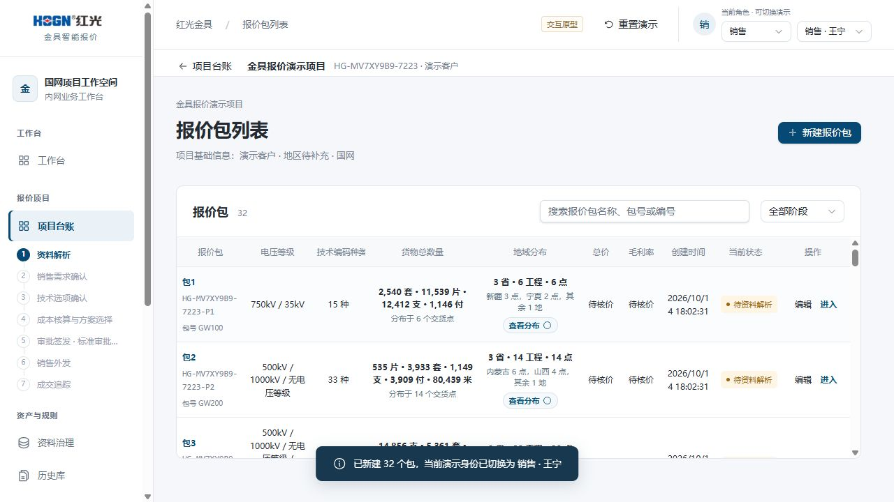

## 4 为本包载入演示技术资料

保持为本包指定的销售人员，在“资料解析”点击“载入演示资料”。即使清单中已有项目物料清单，也可以追加本包技术资料。

系统按包名称载入对应技术规范书目录中的文件。包1会追加15份ZIP技术文件，与原物料清单合计16份；包11保留其技术规范书ZIP原文件。已载入的文件不会重复追加。

本说明按内置演示资料引导操作。当前解析流程及后续货物项使用预置样例展示，不代表这些ZIP文件已被真实模型逐份识别；32个包的汇总来自项目物料清单。

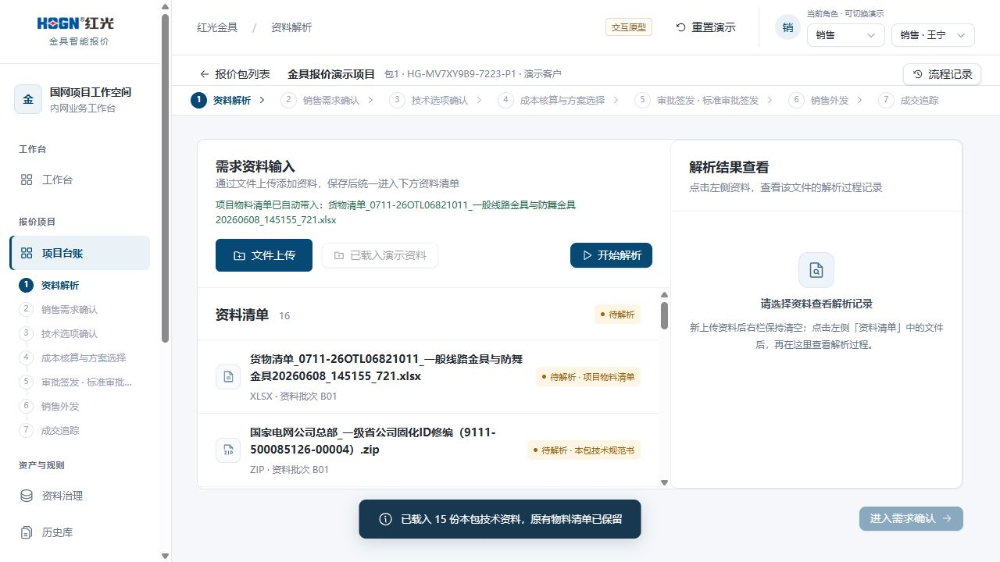

## 5 确认资料并启动解析

核对资料清单后，点击“开始解析”。在弹窗中检查报价包名称及资料数量，再点击“确认开始解析”。

包1的16份资料演示约需48秒。解析过程中请留在当前页面；如需中止，可点击“取消解析”，之后重新发起。

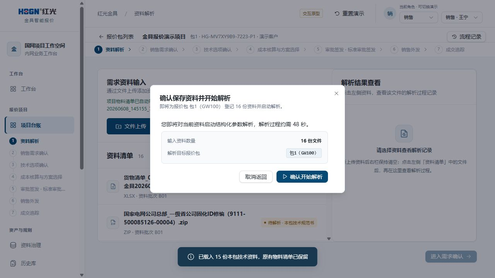

## 6 查看解析进度和完成结果

右侧依次展示资料上传、文档转换、质量检查、结构化解析、风险识别和生成待确认参数六个演示阶段；左侧显示各文件的等待、解析中或已完成状态。

长文件名会在卡片内省略显示，可悬停查看完整名称；窗口较矮时可滚动右侧详情区域。解析完成后进入需求确认页面，查看生成的演示货物项。

查看资料清单中的过程记录与重新解析是两项操作。需要重新生成本轮结果时，请按下一页返回资料解析并点击“重新解析”。

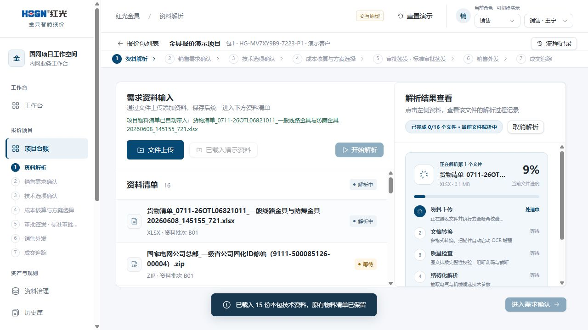

## 7 返回资料解析页面重新解析

在资料整理或销售与技术确认阶段，切换到本包指定销售人员，点击左侧“资料解析”，再点击“重新解析”。

阅读影响提示后点击“确认开始解析”。重新解析会重建演示货物项，覆盖本轮货物项修改，清除当前版本销售和技术确认以及技术指派结果；原资料清单和历史记录保留。

完成后需要重新核对及确认。若包已进入核价或后续流程，需先按业务流程退回可修改阶段；已签发报价的变更可使用“创建报价新版本”。

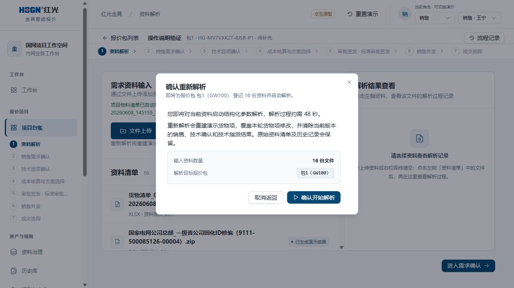

## 8 销售核对需求与本次报价范围

切换为本包指定销售人员，进入“销售需求确认”。核对货物名称、数量、单位及本次报价范围，可用“全部”“已解决”“待解决”筛选。

销售无需补齐全部技术参数，也不要求处理完所有技术问题。串型、子件及技术缺项由技术人员继续核对；销售确认前应保证纳入报价的货物名称、有效数量和单位正确。

宽表格可横向滚动查看后面的状态与操作列。页面生成4条演示货物项用于体验，不等同于包1物料清单的65条真实明细。

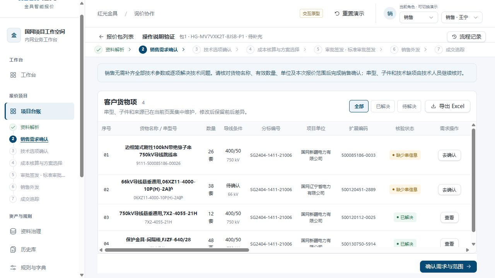

## 9 对照来源核对和修改需求

操作对象：包1 · 货物项01 · 边相笼式刚性100kN带绝缘子串750kV导线跳线串

进入路径：销售需求确认 → 货物项01 → 去确认

在货物项行点击“去确认”或“查看”，打开“解析信息与来源”。左侧查看来源截图，点击图片可放大；右侧核对货物名称、数量、单位、导线条件及清单字段。

需要修改时填写“修改原因与依据”，再点击“保存核对信息”；无须修改则点击“关闭”。保存会记录修改前后差异，相关确认可能需要重新完成。

这里展示的是预置演示清单的来源截图，来源文件名和行号以面板显示为准；它不是当前载入ZIP文件的实时识别证据。

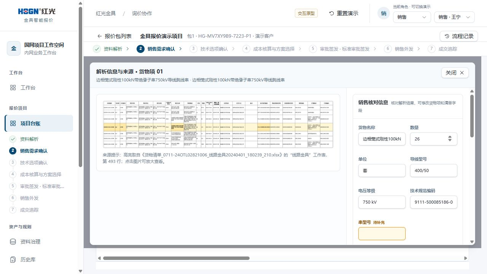

## 10 完成销售确认并交给技术

完成客户需求与报价范围核对后，点击页面下方“确认需求与范围”。销售确认成功后，技术阶段可以继续处理，即使列表仍有技术缺项。

“导出Excel”按当前筛选导出货物项，便于线下复核；它与后续“下载报价单Excel”用途不同。若确认按钮不可用，请检查是否为指定销售、当前阶段以及名称数量单位。

## 11 进入技术选项确认

操作对象：包1 · 全部货物项，先查看01至03的技术缺项

进入路径：技术角色 → 选择技术总监 → 技术选项确认

切换为“技术”，并在当前人员中选择本包的技术总监，例如“技术 · 李总监”，点击“技术选项确认”。仅切换技术角色而仍为普通员工，可能提示无权处理。

技术需要处理全部纳入报价的串型信息和子件信息。查看“核验状态”，分别通过“去确认”和“查看子件”处理缺项；技术确认的完整性要求高于销售确认。

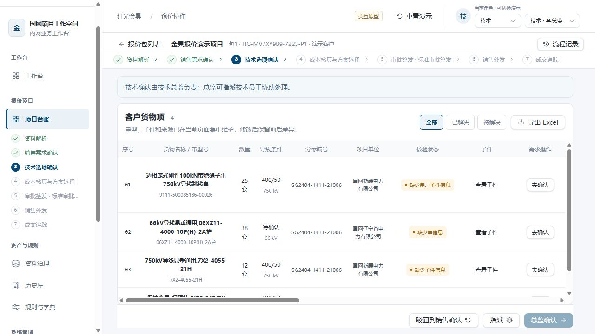

## 12 核对串型信息并保存

操作对象：包1 · 货物项01 · 边相笼式刚性100kN带绝缘子串750kV导线跳线串

进入路径：技术选项确认 → 货物项01 → 去确认 → 修改串信息

点击货物项的“去确认”，对照来源资料核对串型号、电压等级和适用导线。修改时填写原因，点击“保存串信息”。

演示货物项01缺少串型号，可在演示环境填入“跳线串（按技术规范编码匹配）”，并填写按技术规范编码核对的说明，以体验缺项补充。此文字仅为操作示例，正式型号应以技术资料确认值为准。

技术人员继续完善本轮需求时，销售确认可随当前版本延续；若流程被退回或页面提示确认失效，应重新完成相应确认。

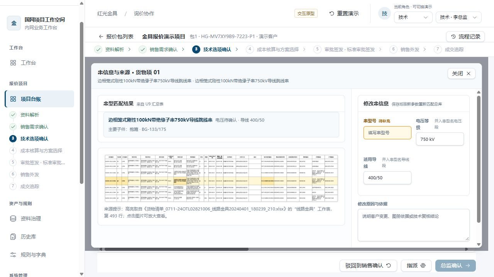

## 13 选择匹配的候选串

操作对象：包1 · 货物项02 · 66kV导线悬垂通用 · 清单原串型号06XZ11-4000-10P(H)-2A护

进入路径：技术选项确认 → 货物项02 → 去确认 → 选择候选串

出现多个候选时，在“选择候选串”中核对电压、导线和型号；可点击“查看候选对比”后选择。候选只进入草稿，填写修改依据并点击“保存串信息”后才生效。

演示货物项02可选择“06XZ11-4000-10P(H)-1A护 · 240/30 · 6项子件”，查看适用导线等参数自动带出，再保存。该例用于体验按条件重新选型，不是对客户真实需求的技术判定。

如果提示当前匹配串与电压或导线不一致，请重新核对并选择；不要仅为推进流程忽略差异。

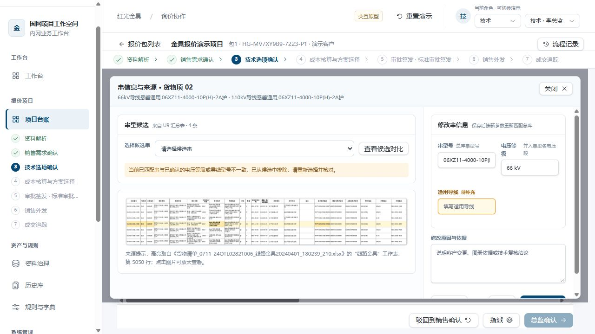

## 14 查看子件并定位缺失字段

操作对象：包1 · 货物项01 · 750kV导线跳线串，查看其子件清单

进入路径：技术选项确认 → 货物项01 → 查看子件

返回技术列表，点击对应货物项的“查看子件”。核对名称、型号、每套用量、材质、U9料号及图号；优先处理显示“缺少信息”的行。

点击子件行的“编辑”查看来源并补充。U9料号在部分普通子件中允许选填，但型号、用量、材质、图号及候选选型等仍需按页面要求完整；保存后技术确认需要复核。

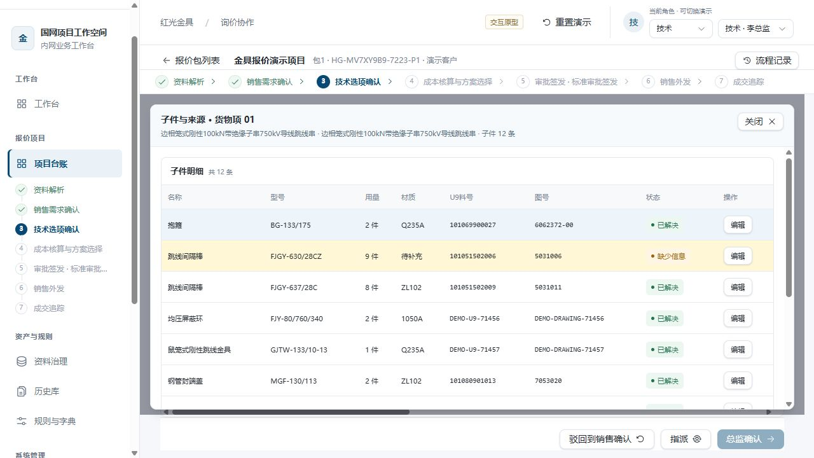

## 15 补充普通子件信息

操作对象：包1 · 货物项01 · 750kV导线跳线串 · 子件跳线间隔棒FJGY-630/28CZ

进入路径：技术选项确认 → 货物项01 → 查看子件 → FJGY-630/28CZ行 → 编辑

在编辑窗口左侧查看来源图片，右侧填写缺失字段。填写“修改原因与依据”后点击“保存子件”，回到清单检查状态是否变为已解决。

演示货物项01的FJGY-630/28CZ跳线间隔棒缺少材质，可在演示环境填写“ZL102”体验补录，并写明演示核对依据。正式项目请使用经技术核验的材质，不直接沿用演示输入值。

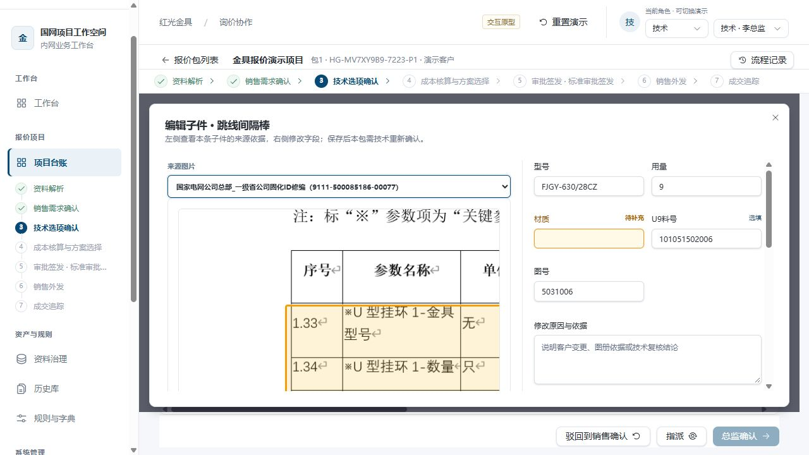

## 15A 测试提醒 无料号子件选择近似参考

操作对象：包1 · 货物项03 · 7X2-4055-21H串 · 子件均压屏蔽环FJD-80/1350/H

进入路径：技术选项确认 → 货物项03 → 查看子件 → 来源行69907 → 编辑 → 参考子件

在技术确认阶段，打开演示货物项03的“查看子件”，找到均压屏蔽环FJD-80/1350/H（来源行69907），点击“编辑”。保留该子件自身型号、用量、材质和图号，U9料号留空。

右侧出现“参考子件”区域后，在“搜索参考子件”输入“均压”或“FJY 760”。从同计价单位的候选中选择均压屏蔽环FJY-80/760/340，核对型号、材质、参考料号和来源。搜索不到时更换关键词；页面只展示前8条候选。

填写修改原因与依据，例如“当前子件暂无料号，核对后参考FJY-80/760/340计算成本”，点击“保存子件”。完成其他技术缺项，再由技术员工提交并经总监确认，或由总监直接确认，随后进入财务核价。

预期结果：保存的是近似子件的参考关系，不会把参考件料号写成当前子件正式料号。当前子件的型号和用量保持不变。若填写了自有U9料号，“参考子件”区域不再显示，核价优先使用自有料号对应依据。

参考子件为选填。没有合适候选时，可保留料号和参考关系为空；这不会单独阻止技术确认，但财务需要填写本次核算成本。其他必填技术字段仍应补齐。

| 测试动作 | 应看到的结果 |
| --- | --- |
| 当前子件U9料号为空 | 出现“参考子件”搜索与候选区域 |
| 搜索并选择近似件 | 显示已选择的名称型号及参考来源 |
| 保存子件并完成总监确认 | 财务可按参考依据带出核算单价 |
| 不选择参考且无自有料号 | 技术仍可按其他完整性条件确认，财务需补价 |
## 16 处理同规格多料号候选

操作对象：包1 · 货物项01 · 750kV导线跳线串 · 子件C型线夹JC-1，绝缘黑色版本

进入路径：技术选项确认 → 货物项01 → 查看子件 → JC-1线夹行 → 编辑 → 料号候选

演示货物项01的JC-1线夹有两条相同规格、不同螺栓版本的候选。点击其“编辑”，根据档案描述选择不锈钢螺栓或热镀锌螺栓版本，查看对应料号与图号。

候选档案未单列材质，需要人工核验并填写。为体验操作，可选择第一条候选并填写演示材质“Q235A”、选型依据，然后保存；此输入仅用于流程演示，不构成真实材质要求。

如“保存子件”仍不可用，检查候选、材质和用量是否已填写，以及当前人员是否具有技术处理权限。

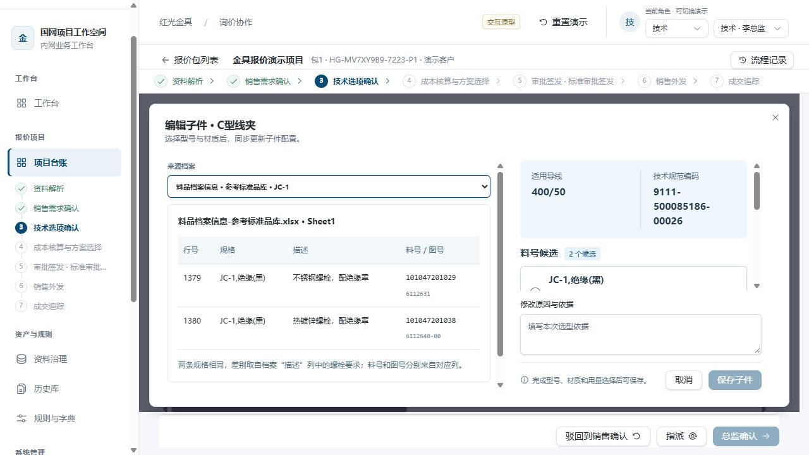

## 17 选择导线包缠物型号和材质

操作对象：包1 · 货物项03 · 750kV导线悬垂通用7X2-4055-21H串 · 子件导线包缠物

进入路径：技术选项确认 → 货物项03 → 查看子件 → 导线包缠物行 → 编辑

在演示货物项03查看子件，编辑“导线包缠物”。对照图纸，在铝包带与护线条之间选择型号，再选择L3或LF10材质，核对用量、料号和图号。

页面有历史推荐时，先核对技术编码、地区、导线及图纸适用条件，再点击“采用推荐”。本例可体验FYH-400/50与LF10组合；填写选型依据后点击“保存子件”。

选择会联动更新相关线夹。页面标明的材质与料号组合为演示映射，历史推荐仅供本次技术核对参考。

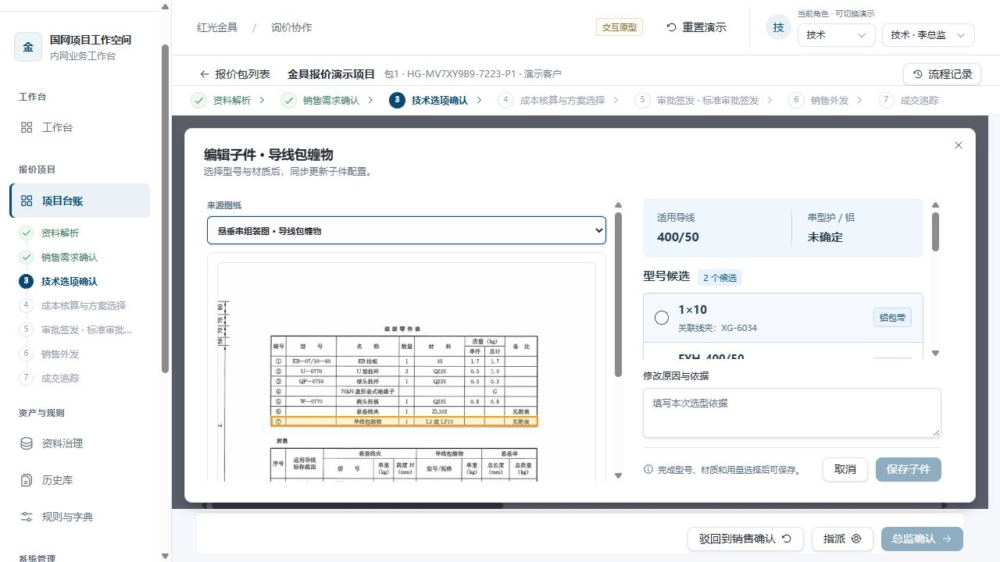

## 18 技术总监指派员工协助处理

操作对象：包1整包技术任务，包含本包全部纳入报价的货物项

进入路径：技术总监身份 → 技术选项确认页下方 → 指派

技术总监可以自行完成全部核对，也可以点击页面下方“指派”，选择技术员工并点击“保存指派”。本例可选择“技术 · 李工”。

员工接到任务后，切换到技术角色及该员工身份，进入本包完成串型与子件缺项处理。指派是协助处理任务，最终确认责任仍由技术总监承担。

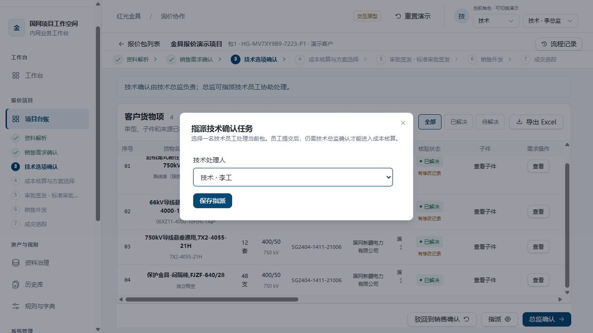

## 19 员工提交与总监最终确认

操作对象：包1整包技术任务，提交前核对全部纳入报价的货物项

进入路径：被指派员工 → 提交总监确认；再切换技术总监 → 总监确认

员工完成全部缺项后点击“提交总监确认”。若按钮不可用，返回串信息和子件清单处理剩余缺项；提交后等待总监复核。

切换回技术总监，查看提交状态及修改摘要。需要返工时点击“驳回到技术人员”并填写原因；认可后点击“总监确认”。总监自行处理的路径也通过“总监确认”完成。

确认完成后，本包进入成本核算阶段，BOM与演示U9价格自动带出。

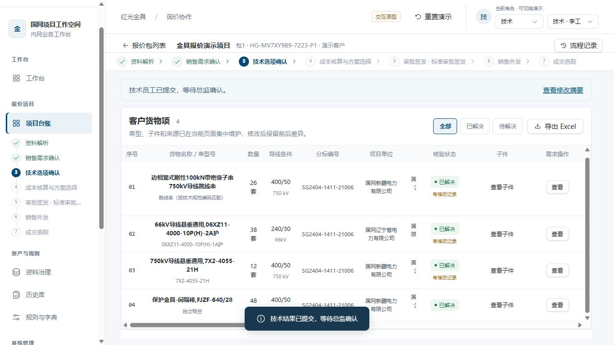

## 20 查看技术确认后的BOM

操作对象：包1整包BOM，按货物项01至04分别查看

进入路径：技术总监确认完成 → 技术选项确认页 → 查看BOM

点击“查看BOM”，检查每个货物项的子件、每套用量、采购数量、总用量、料号和工艺路线。确认数量关系及子件结果后，点击“关闭子件明细”返回。

BOM用于核对技术与成本依据；本说明中的库价、历史价、DEMO料号及图号均为原型演示信息，正式业务数据需另行核验。

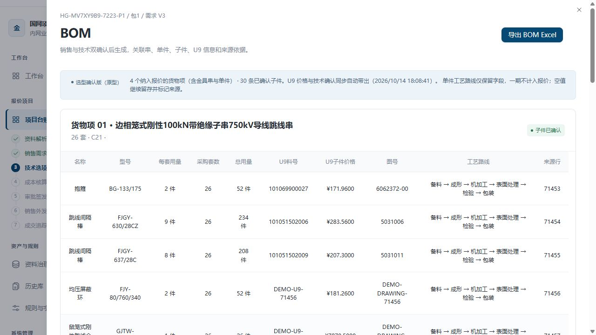

## 21 进入成本核算并检查整包汇总

切换为本包指定财务负责人，点击“成本核算与方案选择”。技术确认完成前不能开始核价。

页面显示子件成本合计、总毛利率、不含税报价和含税报价。先检查缺少价格的提示；演示时可点击“演示一键补齐价格”填入缺失核算价。

演示价格只用于体验成本与报价联动，不作为正式采购或销售价格。

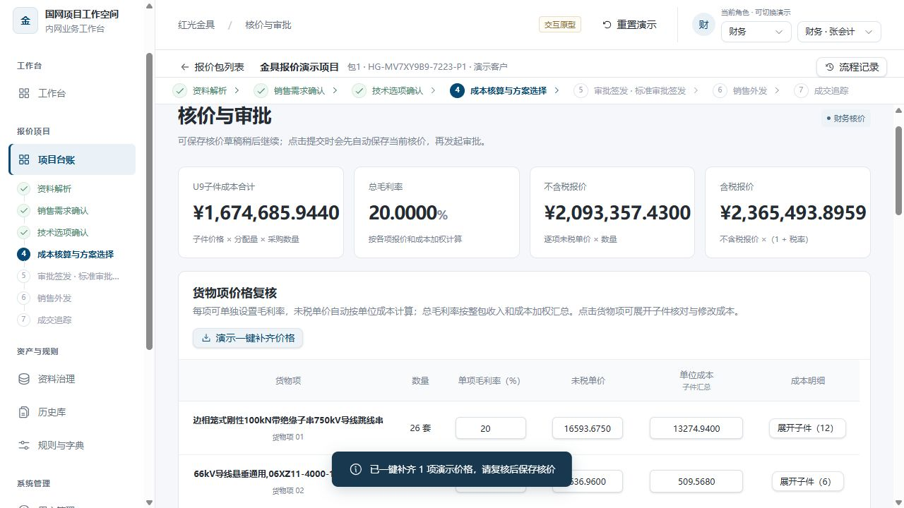

## 22 展开子件核对本次成本

操作对象：包1 · 货物项01 · 750kV导线跳线串的子件成本

进入路径：财务身份 → 成本核算与方案选择 → 货物项01 → 展开子件

在“货物项价格复核”点击“展开子件”。逐行核对每套用量、库中或参考单价、本次核算单价及成本来源；需要调整时修改本次核算单价并填写对应说明。

金具串单位成本按子件单价乘每套用量汇总；独立物资可在其单位成本字段维护。本次成本变化后，对应串的未税单价会按所设毛利率重新计算。

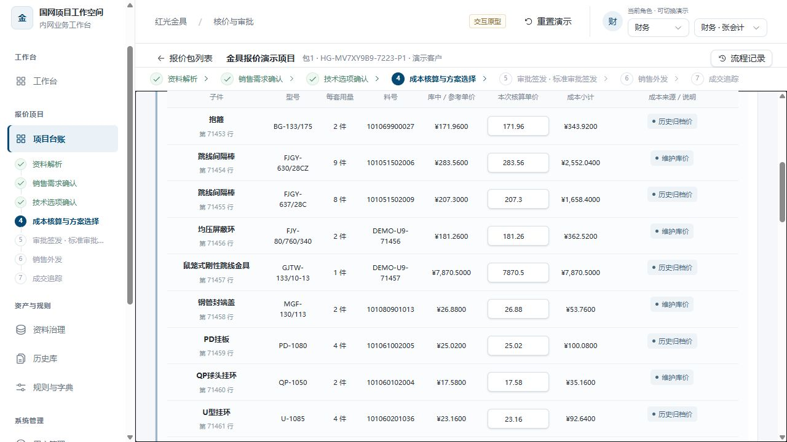

## 22A 测试提醒 验证参考成本自动带出

操作对象：包1 · 货物项03 · 7X2-4055-21H串 · 子件均压屏蔽环FJD-80/1350/H

进入路径：财务身份 → 成本核算与方案选择 → 货物项03 → 含参考子件成本 → 查看成本依据

完成15A节的参考选择和技术总监确认后，切换到本包指定财务人员，进入“成本核算与方案选择”。先检查自动带出的价格，无需为了这条已选参考的子件再点击“演示一键补齐价格”。

点击货物项03单位成本附近的“含参考子件成本”，展开并定位FJD-80/1350/H均压屏蔽环，检查参考单价、本次核算单价和成本来源。

预期显示“参考子件成本”及参考FJY-80/760/340的说明。点击“查看成本依据”核对参考对象、料号、来源行及工艺路线。参考件仅为核算依据，不代表正式替代件。

单价口径提示：当前页面单价仅用于原型演示，尚未按前期双方已确认的公式计算；后续正式开发将采用双方已确认的公式。

本例181.2600元为演示参考单价，不作为正式计算结果或验收依据。本次测试重点是验证参考关系能够带入财务、展示成本依据，并按当前子件用量参与演示汇总。

财务调整本次核算单价后，系统优先采用手工价并保留参考依据，更新串成本及整包报价。其他既无料号也无参考的子件，仍需由财务补充成本。

| 核对位置 | 测试预期 |
| --- | --- |
| 当前子件料号 | 仍可为空，未被参考件料号覆盖 |
| 成本来源 | 显示参考子件成本及对应说明 |
| 参考单价 | 展示原型演示值，本例181.2600元；正式开发采用已确认公式 |
| 成本小计 | 参考或本次核算单价 × 当前子件用量 |
| 财务调整核算价后 | 采用手工价，保留参考说明并更新报价 |
## 23 每串分别设置目标毛利率

操作对象：包1 · 货物项01和02，演示分别设置20%与25%目标毛利率

进入路径：财务身份 → 成本核算与方案选择 → 对应货物项 → 单项毛利率

在各行“单项毛利率（%）”填写目标值，例如第一串20%、第二串25%；各串可以不同。输入后移出输入框，系统自动更新未税单价、整包报价和总毛利率。

毛利率允许0至小于100%。未税单价由单位成本与目标毛利率计算，不直接手填；整包总毛利率按全部报价收入和成本汇总，不是各串百分比的算术平均。

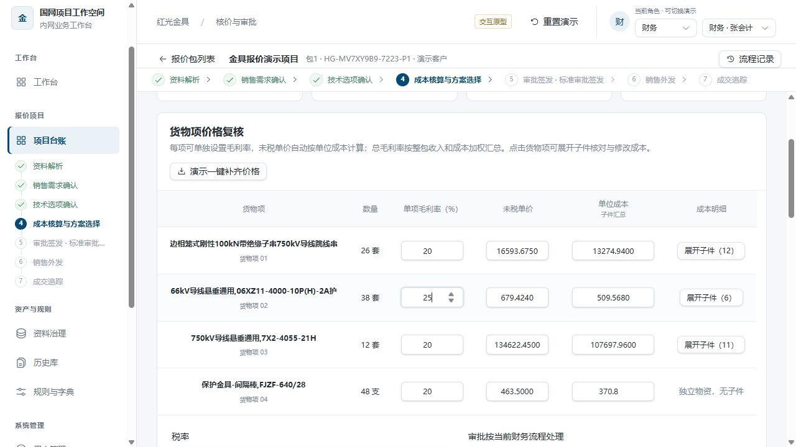

## 24 理解毛利与报价的计算结果

单价口径提示：当前页面单价仅用于原型演示，尚未按前期双方已确认的公式计算；后续正式开发将采用双方已确认的公式。以下关系用于说明当前原型的演示联动，不作为正式公式或验收依据。

演示示例：某串单位成本100元，目标毛利率20%，未税单价为125元；采购10套，未税报价1250元、成本1000元、毛利额250元。税率13%时，含税报价为1412.50元。

该演示示例中，目标毛利率按收入计算，20%不等于在100元成本上加20元。当前原型按下表关系联动；正式计算口径以双方已确认的公式为准。

| 指标 | 当前原型的演示计算方式 |
| --- | --- |
| 每串未税单价 | 单位成本 ÷（1－目标毛利率） |
| 该项未税报价 | 未税单价 × 采购数量 |
| 该项毛利额 | 该项未税报价－该项总成本 |
| 整包总毛利率 | （整包未税报价－整包总成本）÷整包未税报价 × 100% |
| 整包含税报价 | 整包未税报价 ×（1＋税率） |
## 25 保存核价草稿或提交审批

核对税率，在“计价与商务口径”填写币种、税费、运费、有效期等条件。草稿可暂留空，提交审批前必须填写；示例可输入“人民币，税率13%，运费及有效期以双方确认条件为准”。

暂不提交时点击“仅保存核价草稿”。核对完成点击“提交审批签发”，系统先保存当前核价，再校验价格和商务口径并发起审批。

需要技术重核时，使用“驳回到技术选项确认”并填写具体原因；退回后相关确认需按新版本重新完成。

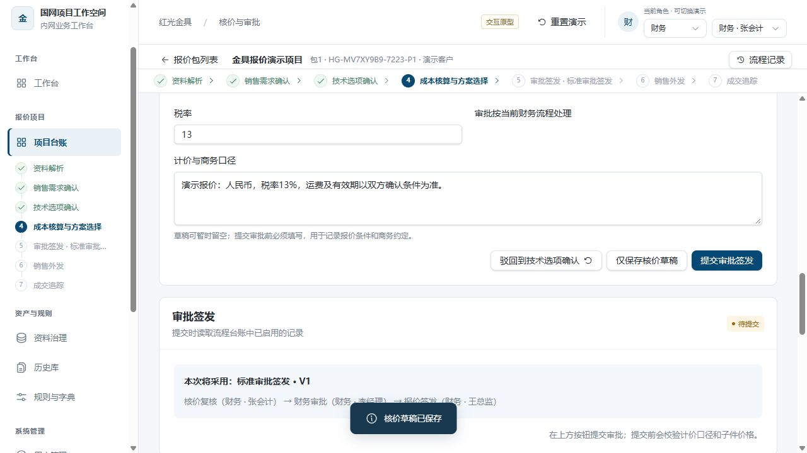

## 26 按当前审批节点提交意见

进入“审批签发”区域，查看当前节点和指定处理人。切换为财务及该人员，点击“通过并流转”，填写审核结论或依据，再点击“确认提交”。

依次处理审批节点，直到最终签发。新建项目时选择的财务负责人会带入本包财务审批节点，以本包实际显示为准，不能只照模板人员切换。

需财务重新核价时点击“退回核价”并填写原因。董事长可查看进度和风险提醒；金额阈值或毛利红线提醒不自动新增董事长审批节点。

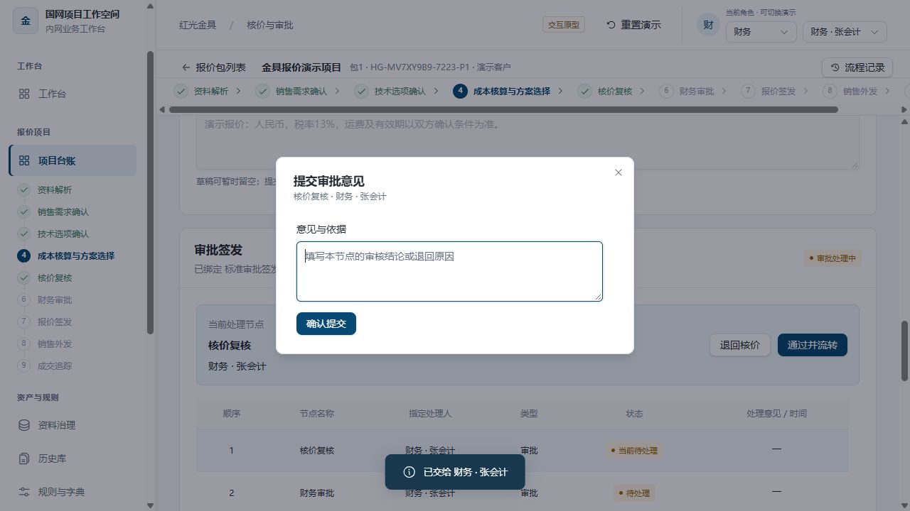

## 27 由指定财务人员签发报价

所有审批节点完成后，查看最终签发节点的指定处理人。切换到该财务人员，核对报价及审批状态，点击“签发正式报价”。

系统保存需求、核价、子件对外报价和审批快照，进入“已签发报价”页面。销售随后可以下载已签发版本；尚未完成审批时不能跳过流程签发。

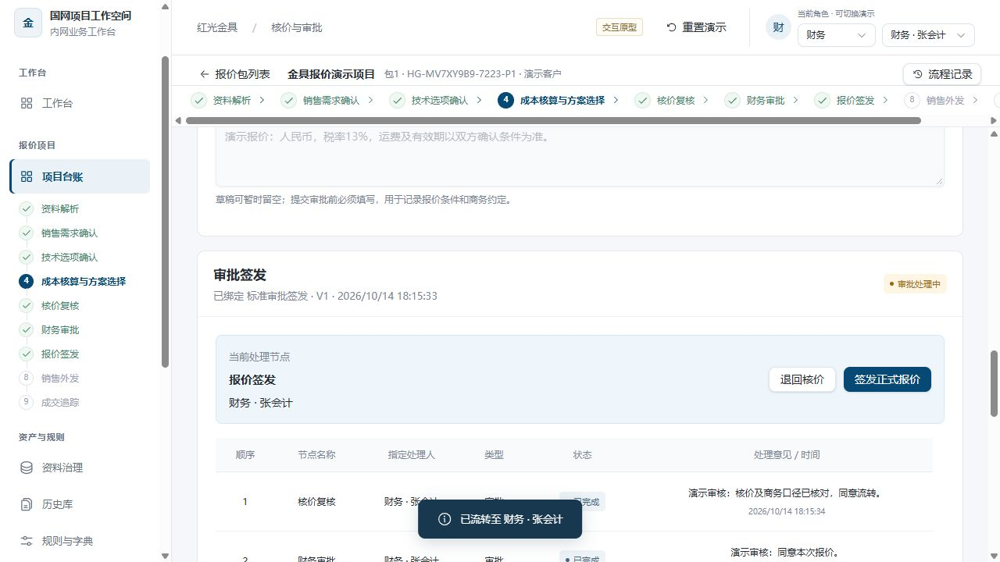

## 28 销售查看下载并登记外发

切换为本包销售负责人，点击“销售外发”。核对已签发报价的版本、未税总额、税率、税额、含税总额和商务条款；点击串行可展开子件对外价格。

点击“下载报价单Excel”保存报价单。确认已经在实际业务中向客户发送后，点击“登记外发”，本包进入客户议价中。

“登记外发”只记录演示业务状态，不会自动发送邮件或消息给客户。

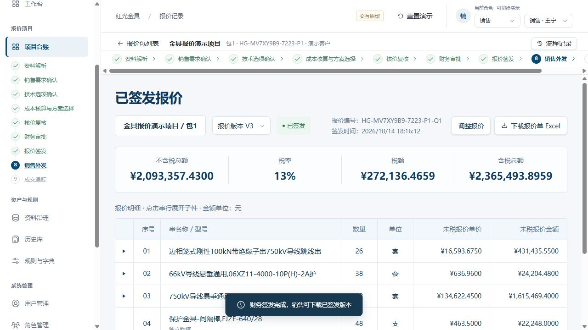

## 29 客户议价时调整报价或新建版本

已出具或客户议价中且尚未归档时，销售可点击“调整报价”，修改串或子件的未税报价。修改串价会按比例联动子件报价；修改子件价会重新汇总串价。

点击“保存报价调整”生效；不保留修改点击“取消修改”。如果是需求、技术或成本依据发生变化，使用“创建报价新版本”，重新完成确认、核价与审批。

下载时若仍有报价调整草稿，系统先尝试保存。本轮正式商务条件仍需按实际客户约定核对。

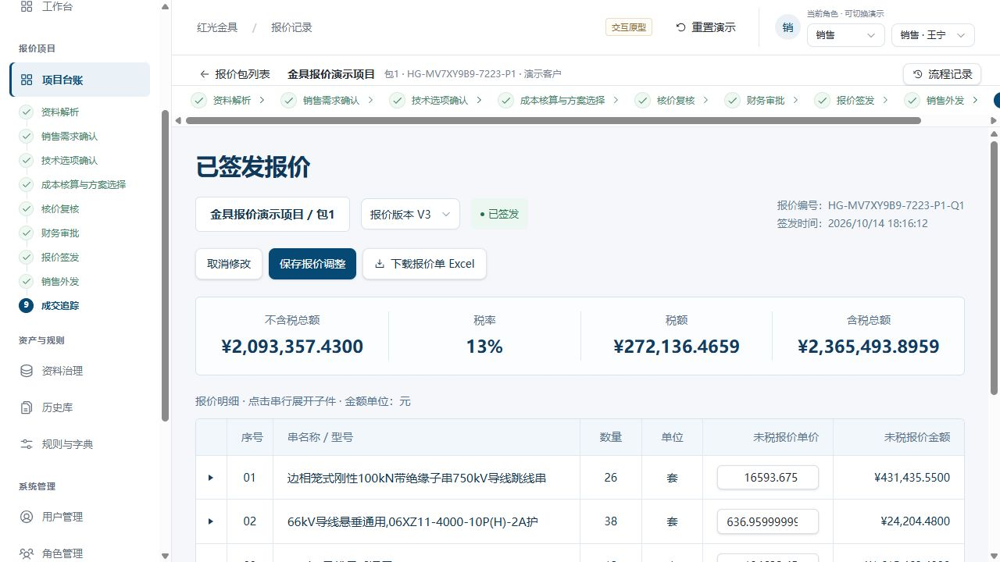

## 30 登记成交结果并归档

外发后点击“成交追踪”或报价页面的“登记成交结果”。选择已成交、未成交或已取消，填写必填的“客户反馈与依据”。

点击“保存并归档入库”。系统保存结果并将本包归档，报价进入只读状态；填写真实结果前，请先核对客户确认或未成交、取消依据。

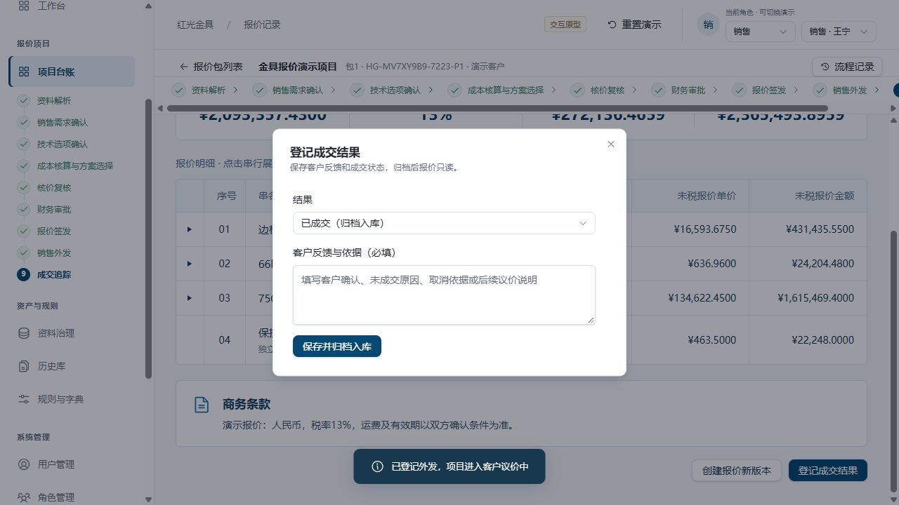

## 31 从历史库查阅归档报价

点击“历史库”，通过项目、包名或客户等信息查找归档包，查看成交状态与报价版本，进入详情查阅已保存报价。

销售可在归档报价详情中使用“取消归档”恢复跟进，再按页面允许的状态继续处理。重新启动需求或技术工作时应创建新版本，保留历史报价记录。

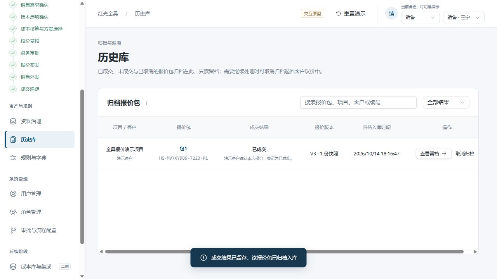

## 32 管理用户并查看在办责任

切换为管理员，点击“用户管理”。使用搜索、角色及状态筛选查找用户，点击“编辑”维护姓名、账号和角色。原型保留一个管理员身份。

本页不提供分配项目。项目操作人员在创建项目时选择；编辑用户后，人员候选及可见页面按其角色和启用状态更新。账号仅用于原型识别，不代表真实登录认证。

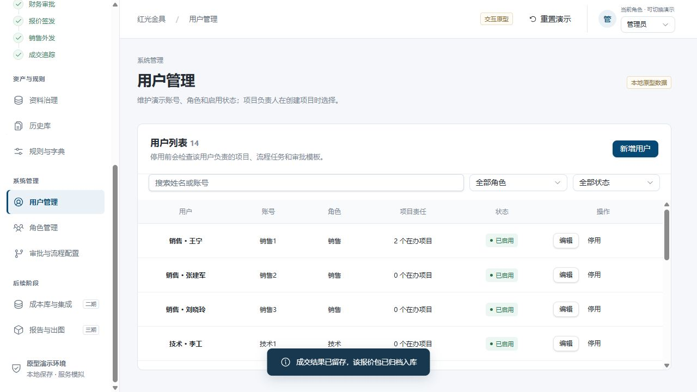

## 33 新增用户并保存

在用户管理点击“新增用户”，填写姓名、演示账号和角色。技术用户还需按页面选择员工或总监岗位。

点击“保存用户”，返回列表检查新增记录；已启用人员可进入相应角色的人员候选。已有项目不会因新增用户而自动转交责任。

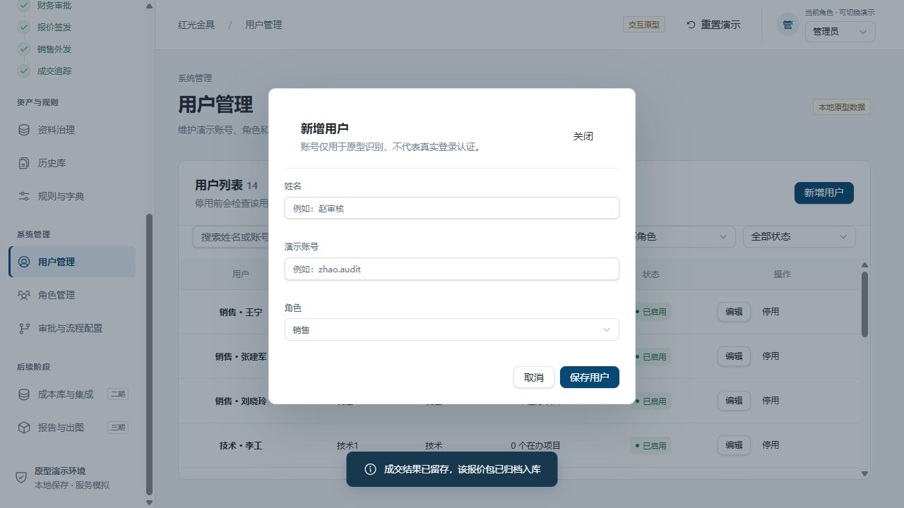

## 34 停用前处理在办项目和任务

点击用户行的“停用”。若该人员仍负责项目、流程任务或当前有效配置，系统阻止停用，并列出相关项目、报价包或配置引用；阅读后点击“知道了”返回。

先完成任务或按业务允许的编辑入口调整负责人及模板引用，再尝试停用。不要通过改名或换角色绕过在办责任；此类变更也可能被阻止。

成功停用后，该人员不能作为新的负责人候选。需要恢复时点击“启用”；同一角色最后一位启用人员也不能直接停用。

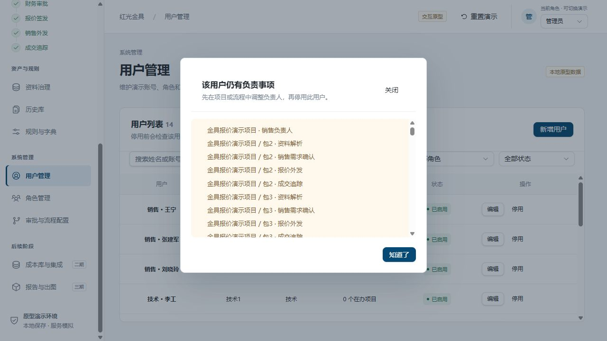

## 35 配置角色页面权限与操作权限

管理员进入“角色管理”，在需要调整的角色列中勾选或取消页面访问和关键操作权限。每次勾选变更会自动保存并立即生效，无需另外点击保存按钮。

切换到相应角色验证效果。左侧导航仍完整展示；没有页面权限时显示权限提示，操作权限则决定是否允许执行相关业务动作。

页面授权仍受系统角色职责约束，不能把财务核价等专业动作任意赋予其他角色。当前原型没有真实账号认证，权限设置用于流程演示。

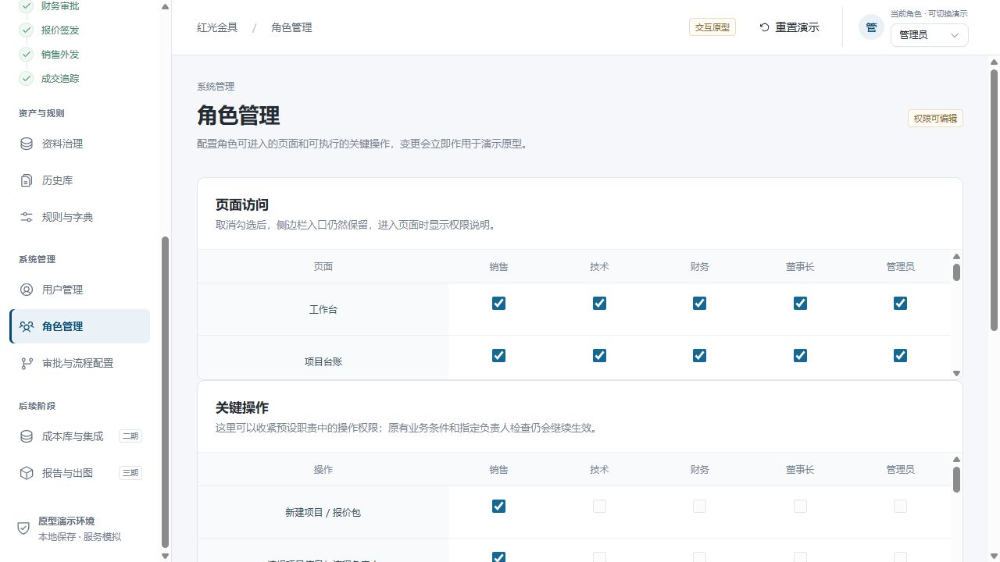

## 36 维护审批流程和默认负责人模板

管理员进入“审批与流程配置”，修改后续阶段默认负责人；在审批签发流程中可修改节点名称和人员，新增审批节点、上移下移或删除。至少保留一位审批人，最终签发固定在最后。

点击“保存配置模板”生成新版本。流程版本记录可启用或停用，创建新报价包前应保持一个有效启用版本；已创建报价包沿用其保存的流程快照。

金额阈值与毛利红线仅董事长可以保存。默认负责人模板不是用户级项目分配，新建项目时仍需确认本项目负责人。

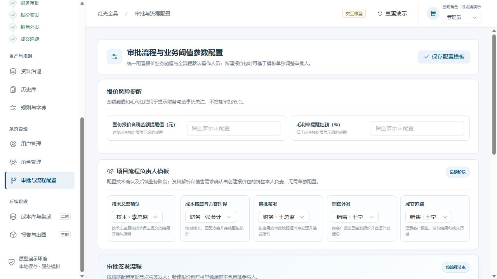

## 37 查看资料治理的来源和版本

默认以管理员身份进入“资料治理”，查看U9辅助映射及国网图册的来源、版本、审核状态和比对说明，点击“查看”打开结构化结果，使用详情右上角关闭按钮返回。

上传及审核发布还要求技术角色并具有页面访问权限。管理员身份下相关按钮可能不可用；如需体验，应先由管理员在角色管理配置技术页面权限，再切换技术。

未发布版本不参与新检索；演示中的上传、拆解与发布不能等同于真实资料处理服务。资料治理用于基础资料管理，本包重新解析应返回“资料解析”页面操作。

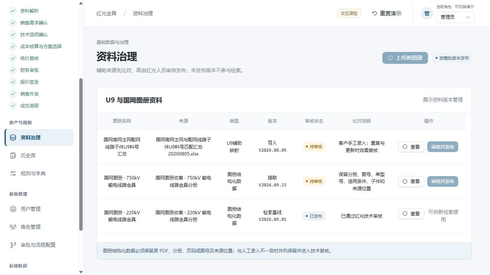

## 38 查阅规则字典与后续功能范围

在“规则与字典”查阅规范字段、常见叫法及必填口径，帮助理解来源资料中的同义名称。本页当前以查看为主，不作为日常报价必经步骤。

“成本库与集成”为二期内容，“报告与出图”为三期内容。当前页面用于展示后续范围，不需要点击这些入口才能完成本说明中的报价流程。

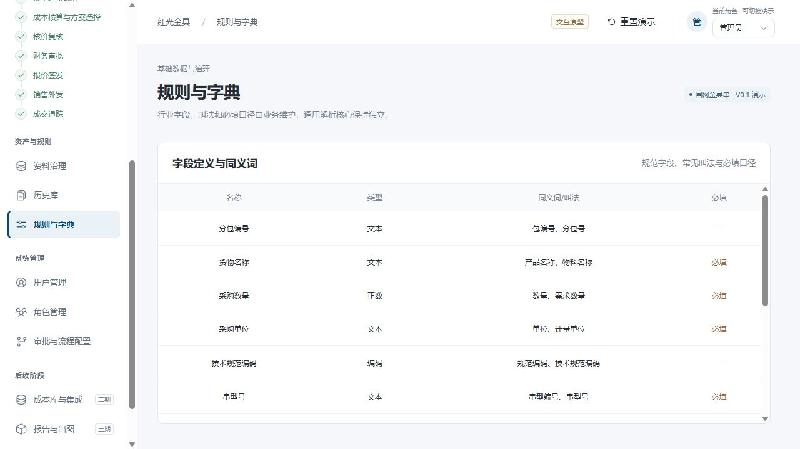

## 39 操作遇到问题时如何继续

按钮灰色：先检查角色和当前人员，再检查前一阶段是否完成、必填值是否补齐，以及操作是否仍处于可修改阶段。菜单可见不代表具有操作权限。

技术不能提交：检查每个金具串的串型号、电压与导线，逐行处理子件缺项、候选、材质、用量和图号。销售确认并不免除技术完整性校验。

核价不能提交：检查缺失成本、毛利率范围、计价与商务口径，以及是否存在有效启用的审批流程。审批无法处理时，以当前节点显示的指定处理人为准。

返回后仍保留数据：当前原型在同一浏览器本地保存，跨设备不会自动同步。不要在正常体验中点击“重置演示”；该操作会清除本地项目、报价包和相关记录。

建议按顺序体验：销售创建项目与解析 → 销售确认 → 技术核对与总监确认 → 财务核价 → 节点审批与签发 → 销售下载外发 → 成交登记与历史查阅。
