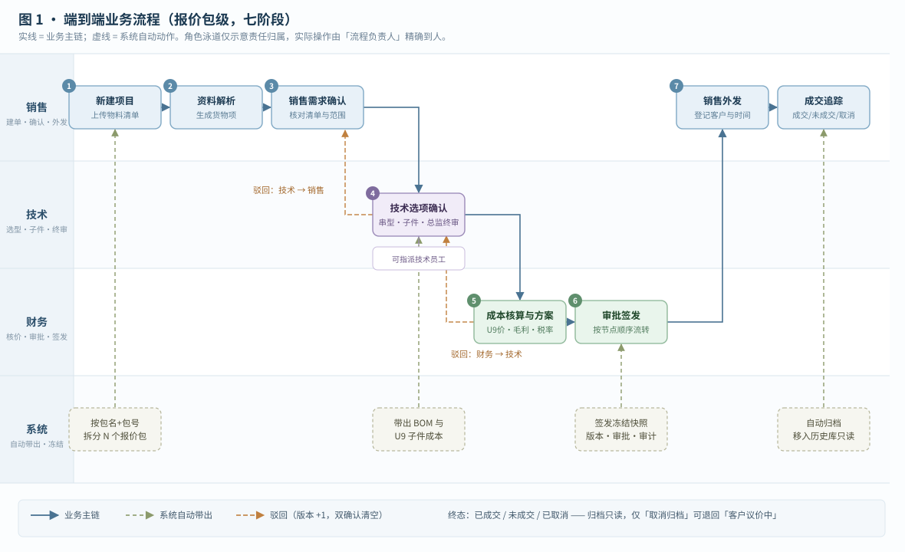
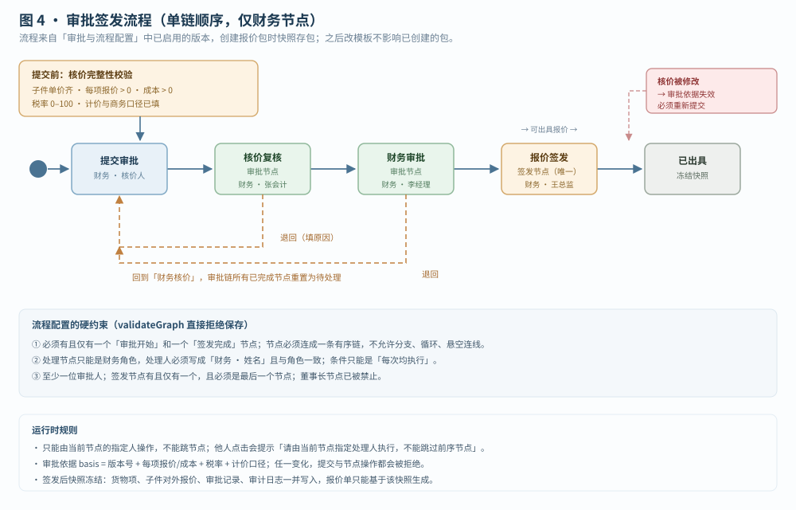
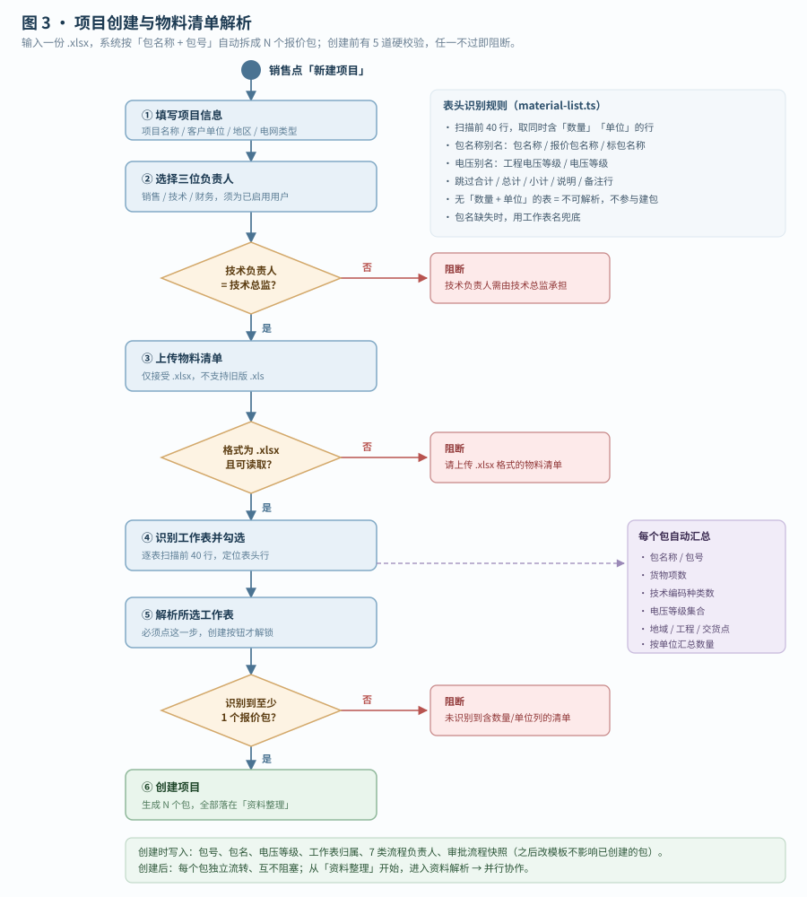
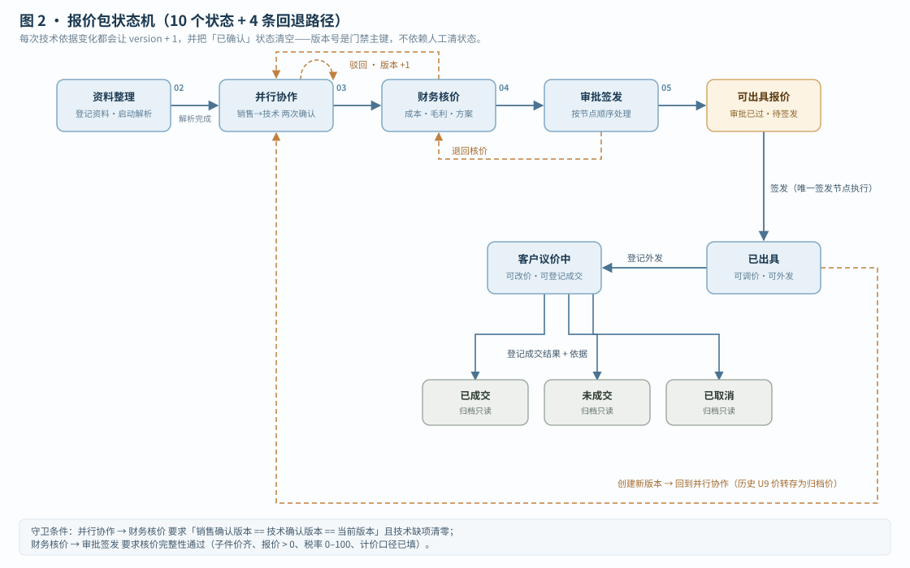

# 红光金具智能报价系统 · 原型功能说明书

| 项 | 内容 |
|---|---|
| 文档版本 | v1.0 |
| 编制日期 | 2026-10-22 |
| 对应代码 | `hogn_prototype-master`，main 分支 `8f86f11` 之后的本地工作副本 |
| 技术栈 | Vue 3.5 + Vite 7 + TypeScript + Pinia 4 + Tailwind v4 + reka-ui + ExcelJS + LogicFlow（审批流设计画布） |
| 证据口径 | **以代码实现为准**。凡 `docs/` 下 PRD/SRS 与本文不一致处，第 11 章单列差异 |
| 适用对象 | 需求评审、客户演示、开发交接、验收对照 |

> 阅读说明：本说明书描述的是**当前可运行原型**的真实行为，不是规划稿。原型中未实现的模块，第 12 章明确列出，不在此处粉饰。

---

## 1. 系统定位与边界

### 1.1 一句话定位

面向**电网金具串询价**场景的报价协作工作台：把客户的一份物料清单 Excel，拆成 N 个报价包，由销售、技术、财务、审批人按固定门禁接力，最终输出可签发的对外报价单。

### 1.2 解决的三个核心问题

| 问题 | 现状痛点 | 系统做法 |
|---|---|---|
| 清单拆包靠人 | 一份 32 包的物料清单，人工按包号拆分、统计电压/数量/交货地，易错 | 自动识别工作表与表头，按「包名称 + 包号」聚合成报价包，同时汇总技术编码种类数、电压等级、各地交货数量 |
| 串型选型无依据 | 销售凭经验报串型号，技术返工 | 三级检索（技术规范编码 → 串型号 → 图册版本/图号），命中后带出 BOM 子件与 U9 成本，差异项逐条提示 |
| 报价边界不清 | 谁改了价格、依据是什么，事后无法追溯 | 每次技术改动/核价/审批/签发均写审计条目 + 版本号；签发时冻结快照，报价单可回溯到子件级 |

### 1.3 原型边界（明确不做）

| 不做的事 | 代码事实 |
|---|---|
| 真实文档解析 | 解析动作为**预置结果**，`start` 动作日志原文「生成预置样例结果；未调用真实解析服务」 |
| 真实 U9 取价 | 子件单价由 `demoPartUnitCost()` 造数，价格来源标记为 archive / maintenance / reference 三档模拟 |
| 真实身份认证 | 角色与人员可在顶栏直接切换，无登录、无鉴权服务 |
| 服务端存储 | 全量数据存 `localStorage`（key `hogn-prototype-v1`），清缓存即丢 |
| 董事长审批 | 已从审批链移除，`validateGraph()` 明确禁止董事长节点 |

---

## 2. 角色与权限

### 2.1 五类角色与演示账号

| 角色 | 演示人员 | 关键特征 |
|---|---|---|
| 销售 | 王宁、张建军、刘晓玲 | 建项目、解析资料、确认客户需求、外发报价、登记成交 |
| 技术 | 李工、周工、高振华、**李总监** | 串型/子件技术确认；**李总监是唯一可做最终技术确认的人** |
| 财务 | 张会计、李经理、王总监、赵会计 | 成本核算、报价定价、提交审批、签发 |
| 董事长 | 陈总、刘总 | 只读核价与报价；维护全局风险提醒阈值（金额/毛利红线） |
| 管理员 | 管理员 | 用户、角色权限、审批流配置 |

### 2.2 页面访问权限（默认矩阵）

| 页面 | 销售 | 技术 | 财务 | 董事长 | 管理员 |
|---|:--:|:--:|:--:|:--:|:--:|
| 工作台 | ✓ | ✓ | ✓ | ✓ | ✓ |
| 项目台账 | ✓ | ✓ | ✓ | ✓ | ✓ |
| 报价包列表 | ✓ | ✓ | ✓ | ✓ | ✓ |
| 资料解析 | ✓ | ✓ | — | — | — |
| 询价协作 | ✓ | ✓ | — | — | — |
| BOM | ✓ | ✓ | ✓ | — | — |
| 核价与审批 | — | — | ✓ | ✓ | — |
| 报价记录 | ✓ | — | ✓ | ✓ | — |
| 资料治理 | — | — | — | — | ✓ |
| 历史库 | ✓ | — | — | — | ✓ |
| 规则与字典 | — | — | — | — | ✓ |
| 用户管理 | — | — | — | — | ✓ |
| 角色管理 | — | — | — | — | ✓ |
| 审批与流程配置 | — | — | ✓ | ✓ | ✓ |

> 页面权限可在「角色管理」中勾选调整，但**关键操作权限有硬底**：`canGrant()` 只允许收紧，不允许把业务上不属于该角色的操作放开。

### 2.3 操作权限（与页面权限分离）

| 操作键 | 含义 | 默认持有 |
|---|---|---|
| `project.create` | 新建项目 / 报价包 | 销售 |
| `project.edit` | 编辑项目信息与流程负责人 | 销售 |
| `inquiry.manage` | 登记资料、启动解析 | 销售 |
| `sales.confirm` | 销售确认需求 | 销售 |
| `technical.manage` | 技术确认与指派 | 技术 |
| `finance.manage` | 修改成本、保存核价 | 财务 |
| `approval.manage` | 提交/处理/签发审批 | 财务、管理员 |
| `quote.manage` | 外发报价、登记成交 | 销售 |
| `settings.manage` | 维护全局风险提醒 | 董事长 |

### 2.4 七类流程负责人（包级，可逐包指定）

新建/编辑报价包时，可分别指定：

| 键 | 流程环节 | 默认人 |
|---|---|---|
| `dataParsing` | 资料解析 | 销售 · 王宁 |
| `salesConfirmation` | 销售需求确认 | 销售 · 王宁 |
| `technicalConfirmation` | 技术选项确认 | 技术 · 李总监（**强制**） |
| `costCalculation` | 成本核算 | 财务 · 张会计 |
| `approvalIssuance` | 审批签发 | 财务 · 王总监 |
| `salesExternal` | 销售外发 | 销售 · 王宁 |
| `dealTracking` | 成交追踪 | 销售 · 王宁 |

两条硬规则：
1. `technicalConfirmation` 在写入时被强制覆盖为「技术 · 李总监」，不可改为普通技术员。
2. 关键环节动作前先校验「当前操作人 == 该环节负责人」，否则报错「当前流程负责人为 X，请切换到指定用户」。这比角色校验更严——**同角色不同人也不能代办**。

---

## 3. 信息架构与页面清单

### 3.1 导航结构

```
工作台
报价项目
  ├─ 项目台账（项目列表 → 进入 → 报价包列表）
  │    └─ 报价包（点包名进入包内工作区）
  │         ├─ 资料解析
  │         ├─ 询价协作
  │         ├─ BOM
  │         ├─ 核价与审批
  │         └─ 报价记录
资产与规则
  ├─ 资料治理
  ├─ 历史库
  └─ 规则与字典
系统管理
  ├─ 用户管理
  ├─ 角色管理
  └─ 审批与流程配置
后续阶段
  ├─ 成本库与集成（二期占位）
  └─ 报告与出图（三期占位）
```

### 3.2 页面功能清单

| 页面 | 核心功能 | 关键交互 | 角色 |
|---|---|---|---|
| 工作台 | 5 个统计卡（项目总数/在办包/我的待办/已签发包/已归档）；按当前人员汇总待办；最近 5 个在办包进度 | 点待办直达对应包的目标页面；销售可直接新建项目 | 全部 |
| 项目台账 | 项目列表（名称/客户/地区/电网类型/包数/负责人/创建时间） | 编辑项目、进入项目看包列表 | 全部 |
| 报价包列表 | 按类别筛选；列显示电压等级、技术编码种类数、货物总数量、地域分布、总价、毛利率、状态；多选批量进入 | 点包名进入；勾选多包 → 批量进入（同环节才允许）；待解析清单、编辑、操作记录 | 全部（金额列受角色限制） |
| 资料解析 | 登记资料（上传/载入演示资料）、启动解析、逐文件状态、解析结果摘要 | 「开始解析」有二次确认；未解析时「进入需求确认」禁用 | 销售、技术（技术只读） |
| 询价协作 | 货物项表（原始字段 + 核验状态 + 子件数 + 需求操作）；串型检索与选型；子件编辑；技术驳回；批量确认 | 查看子件抽屉、候选对比、修改依据必填、导出协作清单 | 销售、技术（视图不同） |
| BOM | 双确认后生成的串—子件—U9 明细表；导出 BOM（含用量与来源、平行挂板、说明页） | 未双确认时显示「BOM 尚未开放」，不可绕过 | 销售、技术、财务 |
| 核价与审批 | 子件成本、本次核算价、单项毛利率、未税/含税价、报价方案（保守/标准/竞争/自定义）、风险提醒、提交审批、审批节点操作、签发 | 一键补齐演示价格；改子件成本实时重算串成本；提交前自动保存核价 | 财务、董事长（只读） |
| 报价记录 | 已签发报价明细（串 + 子件）、调整对外报价、下载报价单 Excel、登记外发、登记成交结果 | 只能改最新签发版本；改价后汇总与下载文件同步更新 | 销售、财务、董事长 |
| 历史库 | 归档包列表 + 串/子件留存明细；查看核价、查看留档、取消归档 | 归档包只读 | 销售、管理员 |
| 资料治理 | 图册资料来源、版本、审核状态；上传 PDF/Excel 拆解；审核并发布 | 未发布版本不参与检索（业务声明） | 管理员 |
| 规则与字典 | 字段定义、同义词、必填口径 | 只读/维护 | 管理员 |
| 用户管理 | 演示账号增删改停用；停用前检查其负责的项目与任务 | 仅管理员可维护 | 管理员 |
| 角色管理 | 页面访问 + 关键操作权限矩阵 | 权限变更立即生效 | 管理员 |
| 审批与流程配置 | 风险提醒阈值（含税金额/毛利红线）、流程负责人模板、审批节点增删上下移、流程版本启用 | 已创建包沿用创建时的流程快照 | 财务、董事长、管理员 |

---

## 4. 端到端业务流程

### 4.1 主流程七阶段



| # | 流程条节点 | 责任角色 | 进入下一节点的判定 | 对应页面 |
|---|---|---|---|---|
| 1 | 资料解析 | 销售 | 资料登记完成且已启动解析（生成货物项） | 资料解析 |
| 2 | 销售需求确认 | 销售 | `salesConfirmed === version`，且纳入项的名称/数量/单位齐全 | 询价协作 |
| 3 | 技术选项确认 | 技术（总监终审） | `techConfirmed === version`，且无序型/子件缺项、无技术阻断 | 询价协作 |
| 4 | 成本核算与方案选择 | 财务 | 无（核价是财务的持续动作，提交审批才校验完整性） | 核价与审批 |
| 5 | 审批节点（动态） | 财务审批人 | 按流程快照顺序逐节点通过，且审批依据未变化 | 核价与审批 |
| 6 | 销售外发 | 销售 | 已签发 → 登记外发时间与客户 | 报价记录 |
| 7 | 成交追踪 | 销售 | 登记成交/未成交/取消 → 自动归档 | 报价记录 → 历史库 |

### 4.2 阶段 × 页面 × 角色 映射

| 业务阶段 `stage` | 默认落地页 | 可写角色 | 说明 |
|---|---|---|---|
| 资料整理 | 资料解析 | 销售 | 只有资料负责人可上传与解析 |
| 并行协作 | 询价协作 | 销售、技术 | 销售先确认，技术后确认；不是真并行，有先后依赖 |
| 财务核价 | 核价与审批 | 财务 | 技术总监确认时自动带出 BOM 与 U9 价格 |
| 审批签发 | 核价与审批 | 当前审批节点人 | 多节点顺序流转 |
| 可出具报价 | 核价与审批 | 签发节点人 | 审批已过，等待执行「签发」动作 |
| 已出具 | 报价记录 | 销售 | 可调整对外报价、登记外发 |
| 客户议价中 | 报价记录 | 销售 | 可继续改价、登记成交结果 |
| 已成交 / 未成交 / 已取消 | 报价记录 | — | 终态，自动归档，只读 |

### 4.3 「并行协作」的真实含义

名字叫并行，代码是**串行门禁**：

1. 销售先完成 `confirmSales`（把 `salesConfirmed` 打成当前版本号）。
2. 技术才能确认：`confirmTech` 首先校验 `salesConfirmed === version`，否则报「请先等待销售完成需求确认」。
3. 技术侧可选「总监自己完成」或「指派技术员工」：
   - 员工模式下，员工改完必须点「提交技术结果」，状态 `assigned → submitted`；
   - 总监可「退回并通知技术人员」，状态回 `assigned`，退回原因留痕；
   - 最终 `confirmTech` 只有技术总监能点。
4. 双确认齐了，`canFinance()` 才为真。

> 注意：技术员工只能看到**指派给自己的包**（`technicalWorkflowScope` 过滤），台账会出现「当前工作表下暂无可见报价包」。这是设计，不是 bug，但演示前必须切到对应人员。

### 4.4 财务核价

| 步骤 | 动作 | 系统行为 |
|---|---|---|
| 1 | 打开核价页 | 展示子件成本明细（U9 价 / 参考子件成本 / 本次核算价三列） |
| 2 | 修改子件核算价 | 实时重算「串单位成本 = Σ(子件单价 × 每套用量)」，缺项单独计数 |
| 3 | 设定单项毛利率 | 未税单价 = 成本 ÷ (1 − 毛利率)；含税 = 未税 × (1 + 税率) |
| 4 | 选报价方案 | 保守 25% / 标准 20% / 竞争 15% / 自定义 10%，可逐项覆盖 |
| 5 | 查看风险提醒 | 含税总额 ≥ 金额阈值、毛利率 < 红线、手工标记特殊商务事项，三类提示**只提醒、不加审批节点** |
| 6 | 保存核价 | 写草稿；税率、计价口径、风险标记一并落库 |
| 7 | 提交审批 | 先跑完整性校验（见 7.4），通过后按流程快照生成审批链 |

### 4.5 审批签发



- 审批链来自「审批与流程配置」中**已启用**的流程版本，按连线顺序执行，不看画布位置。
- 流程被复制成**快照**存进报价包，之后改模板不影响已创建的包。
- 节点动作只有两种：`approve`（审批）/ `issue`（签发）。**最后一个节点必须是唯一的签发节点。**
- 只能由「当前节点指定人」操作，不能跳节点；`run.basis` 与当前核价依据比对，核价一改，审批立即失效，需重新提交。
- 签发动作会冻结快照：货物项、子件对外报价、审批记录、审计日志全部写入 `snapshots[0]`，此后报价单只能基于快照生成。

### 4.6 外发与成交

| 动作 | 前置 | 结果 |
|---|---|---|
| 调整报价 | 阶段 ∈ {已出具, 客户议价中} 且未归档；只能改最新快照 | 串价与子件价同步改写，重算含税总额，写审计 |
| 登记外发 | 阶段 = 已出具 | `stage → 客户议价中`，记录外发时间 |
| 登记成交 | 阶段 = 客户议价中，必须填结果 + 依据 | `stage → 已成交/未成交/已取消`，写 `archivedAt`，从在办列表移入历史库 |
| 取消归档 | 阶段 ∈ 三个终态 | 回到「客户议价中」，原成交记录保留在日志 |

---

## 5. 关键子流程

### 5.1 项目创建与物料清单解析



**输入要求**：`.xlsx`（明确拒绝 `.xls`）；必须选择销售/技术/财务三位负责人；技术负责人必须是技术总监。

**解析规则（`material-list.ts`）**：

| 规则 | 实现 |
|---|---|
| 表头识别 | 每个工作表扫描前 40 行，找到同时含「数量」和「单位」列的行作为表头 |
| 列名兼容 | 每类字段支持 2–3 个别名，如包名称 = 包名称/报价包名称/标包名称；电压 = 工程电压等级/电压等级 |
| 无效行过滤 | 以「合计/总计/小计/说明/备注」开头的行跳过；空行跳过；重复表头行跳过 |
| 拆包键 | `包名称 + 包号`；包名称缺失时用工作表名兜底 |
| 包级汇总 | 货物项数、技术规范编码种类数（去重）、电压等级集合、按单位汇总数量 |
| 交货地汇总 | 按「省份 + 工程名称 + 交货地点」三元组聚合；省份用 34 个省级别名匹配，匹配不到记「地域待确认」 |
| 工作表归属 | 每个包记住 `sourceWorksheetId`，后续按类别筛选、统计都依赖它 |

**创建时的硬校验**（任一不满足则「创建项目」按钮禁用或报错）：

1. 项目名称非空；
2. 物料清单文件后缀为 `.xlsx`；
3. 三个负责人均为**已启用**且角色匹配的用户，技术负责人 ∈ {李总监}；
4. 至少选择一个工作表，且**已完成解析**（`已解析的工作表集合 === 当前勾选集合`，这是最容易卡住外部演示的一条）；
5. 每个报价包的 `sourceWorksheetId` 必须落在所选工作表集合内；
6. 至少识别出 1 个报价包。

> 解析后必须点「解析所选工作表」，「创建项目」才会解锁。只点「载入演示文档」不解析，按钮会一直灰着且无提示。

### 5.2 串型检索与选型

四条检索路由，自动模式按顺序尝试：

| 路由 | 匹配键 | 说明 |
|---|---|---|
| 0 | 技术规范编码 `spec` | 最精确，优先 |
| 1 | 串型号 `model` | 支持护/铝后缀容差：无后缀时可匹配两种包缠物配置 |
| 2 | 图册版本 + 图号 | 图册版本必须一致，图号命中主图号或备用图号均可 |
| 3 | 兜底 | 前三路全空时按货物名称前 8 字模糊匹配 |

命中后按「差异项数量」升序排序，差异维度：电压等级、适用导线、串型号、图册版本、图号。差异只做展示，**不阻断采用**。

**采用候选时实际生效的校验**（`select` 动作）：

| 校验 | 说明 |
|---|---|
| 候选必须存在于图册库 | 否则报「候选不存在」 |
| 独立物资不能选串型 | 否则报「独立物资不能选择串型」 |
| 必须填写匹配条件与选定依据 | 否则报「请填写匹配条件及选定依据」 |
| 阶段必须可编辑 | 已进下游则要求退回或建新版本 |
| 技术员工只能改被指派的包 | 否则报「当前包技术任务未指派给你」 |

> **实证提醒**：`candidateAdoptionIssues()`（强制技术角色采用、阶段限制、导线补齐、差异逐条拦截）已在 `model.ts` 中定义并在 `store.ts` 里 import，但**全仓无任何调用点**——这组规则目前是死代码，不生效。选型差异只影响排序与展示。

### 5.3 技术指派

```
技术总监 → 选择包（可多选）→ 指定技术员工 → 员工处理 → 提交 → 总监确认 / 退回
```

| 状态 | 含义 | 谁可操作 |
|---|---|---|
| `assigned` | 已指派待处理 | 被指派员工 |
| `submitted` | 员工已提交，等总监确认 | 技术总监 |
| 退回 | 状态回 `assigned` + 退回原因 | 技术总监 |

指派前校验：操作人必须是技术总监；包的销售确认必须已完成（`salesConfirmed === version`）；包未归档且处于并行协作阶段。
指派后员工**只能看到被指派的包**，且提交时会校验「变更摘要」，把本人改动按货物项汇总给总监。

### 5.4 版本失效与重走

任何技术依据变化都会调用 `invalidate()`：

| 触发动作 | 后果 |
|---|---|
| 重新解析资料 | 重建货物项、清空双确认 |
| 修改串型参数 / 编辑子件 / 改报价范围 | `version + 1`；`salesConfirmed`、`techConfirmed` 置空；U9 成本与带出结果清空；审批 run 若在跑则置 `returned` |
| 财务侧改价后提交新审批 | 旧审批进 `approvalHistory`，新建 run |
| 已签发后「创建新版本」 | 历史 U9 价转存 `historicalU9Data`，新版本沿用归档价，技术确认后再刷新维护库价 |

> 关键设计：**版本号是门禁的主键**。所有「已确认」都存成 `xxx === version`，版本一变自动失效，不依赖人工清理状态。

### 5.5 批量处理

| 能力 | 前提 | 行为 |
|---|---|---|
| 批量进入 | 同项目、均未归档、**下一步动作完全一致**（capability key 相同） | 任一包无权或环节不同即拒绝，并说明原因 |
| 批量解析 | 销售 + 解析权限 + 全部包均为本人负责 + 阶段 ∈ {资料整理, 并行协作} | 首包保留待确认项，其余包预填完整 |
| 批量确认销售/技术 | 同一环节 | 逐包执行，结果逐包回显（成功/失败原因） |
| 批量指派技术 | 技术总监 + 包均已销售确认 | 可全选，逐个写 `technicalExecution` |
| 聚合视图 | 已批量进入 | BOM/核价/报价按包分节渲染，各包税率、成本、审批、版本独立，互不影响 |

---

## 6. 状态机



### 6.1 状态定义

| 状态 | 类型 | 可写动作 | 出口 |
|---|---|---|---|
| 资料整理 | 在办 | 登记资料、启动解析、编辑包信息 | → 并行协作 |
| 并行协作 | 在办 | 销售确认、技术编辑/选型、指派、技术确认、驳回 | → 财务核价（双确认后）；回退到自己（版本+1） |
| 财务核价 | 在办 | 改子件成本、改价、保存核价、提交审批、驳回 | → 审批签发 / 可出具报价 |
| 审批签发 | 在办 | 当前节点通过、退回 | → 下一节点 / 可出具报价 / 财务核价 |
| 可出具报价 | 在办 | 签发节点执行签发 | → 已出具 |
| 已出具 | 在办 | 调整对外报价、登记外发、创建新版本 | → 客户议价中 / 并行协作（新版本） |
| 客户议价中 | 在办 | 调整报价、登记成交、创建新版本 | → 已成交 / 未成交 / 已取消 |
| 已成交 / 未成交 / 已取消 | 终态 | 仅「取消归档」 | → 客户议价中 |

### 6.2 允许的状态迁移（含守卫条件）

| From → To | 触发 | 守卫 |
|---|---|---|
| 资料整理 → 并行协作 | 启动解析 | 有资料；包可编辑 |
| 并行协作 → 财务核价 | 技术总监确认 | 销售已确认 + 技术信息完整 + 无技术阻断 |
| 并行协作 → 并行协作 | 任一技术改动 | 版本 +1，双确认清空 |
| 财务核价 → 并行协作 | 技术驳回 / 退回到技术 | 必须填原因 |
| 财务核价 → 审批签发/可出具报价 | 提交审批 | 核价完整性校验通过；存在已启用流程 |
| 审批签发 → 审批签发 | 节点通过 | 当前节点指定人；`basis` 未变 |
| 审批签发 → 财务核价 | 审批退回 | 当前节点人；填原因；run 重置为 pending |
| 可出具报价 → 已出具 | 签发 | 当前节点 action=issue 且本人 |
| 已出具 → 客户议价中 | 登记外发 | 外发负责人 |
| 客户议价中 → 终态 | 登记成交 | 必须选结果 + 填依据 |
| 终态 → 客户议价中 | 取消归档 | 成交记录保留 |

> 遗留态「董事长审批」在读取时被 `normalizePackage()` 自动迁移：若当前节点是签发 → 可出具报价，否则 → 财务核价。董事长角色只读。

---

## 7. 业务规则与门禁清单

### 7.1 项目与资料

| ID | 规则 | 校验点 | 违反提示 |
|---|---|---|---|
| R-01 | 物料清单仅支持 `.xlsx` | 新建项目 | 请上传 .xlsx 格式的物料清单 |
| R-02 | 必须选择并解析工作表 | 新建项目 | 请先选择并解析至少一个工作表 |
| R-03 | 技术负责人必须是技术总监 | 新建/编辑 | 技术负责人需由技术总监承担确认责任 |
| R-04 | 负责人必须是已启用用户 | 新建/编辑 | X 不是已启用的 Y 用户 |
| R-05 | 解析前不可进入需求确认 | 资料解析页 | 按钮禁用 |
| R-06 | 重新解析会作废已确认结果 | 启动解析 | 版本 +1，双确认清空 |

### 7.2 销售确认

| ID | 规则 | 违反提示 |
|---|---|---|
| R-07 | 必须有纳入报价的货物项 | 本次报价没有纳入报价的货物项 |
| R-08 | 名称、数量、单位齐全 | 请补齐货物名称、有效数量和单位 |
| R-09 | 排除货物项必须写范围与依据 | 需说明不纳入本次报价的范围及依据 |
| R-10 | 修改货物项必须写来源与原因 | 修改必须填写来源和原因 |

### 7.3 技术确认

| ID | 规则 | 违反提示 |
|---|---|---|
| R-11 | 必须销售先确认 | 请先等待销售完成需求确认 |
| R-12 | 串信息完整（适用导线、串型号、电压等级） | 技术信息未填写完整（N 项）：… |
| R-13 | 子件完整（型号、用量、材质、图号、候选选型、参考子件） | 同上，精确到「子件 X 缺少 Y」 |
| R-14 | 技术阻断项必须清零 | 还有 N 项技术阻断，请先处理 |
| R-15 | 只有技术总监可做最终确认 | 仅技术总监可以确认并推进技术流程 |
| R-16 | 员工已提交才能被总监确认 | 请等待被指派的技术员工提交结果 |
| R-17 | 候选采用的技术强制校验 | （**未生效**）`candidateAdoptionIssues()` 无调用点，选型差异不阻断 |
| R-18 | 串型号与候选不一致（允许护/铝后缀容差） | 仅列为差异项并影响排序，不阻断 |

### 7.4 核价与审批

| ID | 规则 | 违反提示 |
|---|---|---|
| R-19 | 核价前必须双确认 | 需销售、技术确认当前版本，且核价前阻断全部解除 |
| R-20 | 至少保留一个报价项 | 至少保留一个报价货物项 |
| R-21 | 计价与商务口径必填 | 请填写计价与商务口径 |
| R-22 | 税率 0–100 | 税率需在 0–100 之间 |
| R-23 | 每项报价 > 0、成本 > 0 | 货物项的报价无效 / 成本未补齐 |
| R-24 | 子件单价必须补齐 | 以下货物项仍有子件单价待补齐：… |
| R-25 | 只能当前审批节点人操作 | 请由当前节点指定处理人执行，不能跳过前序节点 |
| R-26 | 核价依据变化即审批失效 | 核价或审批依据已变化，请重新提交审批签发 |
| R-27 | 签发前必须审批完成 | 审批尚未完成，不能签发 |
| R-28 | 最后一个节点必须是唯一签发节点 | 流程校验直接拒绝保存 |

### 7.5 报价与外发

| ID | 规则 | 违反提示 |
|---|---|---|
| R-29 | 只能改最新签发版本 | 只能调整最新签发的报价版本 |
| R-30 | 报价明细必须完整、单价非负 | 报价明细不完整 / 单价必须为非负数 |
| R-31 | 仅已签发可外发 | 仅已签发报价可登记外发 |
| R-32 | 成交必须选结果 + 填依据 | 请选择成交结果并填写依据 |
| R-33 | 归档包只读 | 已归档报价包仅可查看 |

---

## 8. 数据模型

```
Project（项目）
 ├─ 基本信息：名称、客户、地区、电网类型、寒区标准
 ├─ 物料清单文件 + 工作表集合（materialWorksheets）
 └─ Package[]（报价包）
      ├─ 标识：packageNo、packageName、voltageLevel、materialWorksheetId
      ├─ 状态：stage、version、archivedAt、financeReachedAt
      ├─ 双确认：salesConfirmed、techConfirmed（存版本号）
      ├─ 流程：processParticipants（7 类负责人）、approvalFlowSnapshot、approvalRun / approvalHistory
      ├─ 技术：technicalExecution（director / employee + assigned / submitted）、rejection
      ├─ 明细：Item[]
      │    └─ Part[]（子件：型号、用量、材质、U9 料号、图号、工艺路线、候选选型、参考子件、技术变更）
      ├─ 价格：tax、pricingNote、pricingSchemes、selectedSchemeId、u9Data / historicalU9Data
      ├─ 快照：Snapshot[]（version、items、quoteParts、approval、audit、total、cost）
      └─ 审计：Audit[]（时间、角色、动作、明细、版本、变更前后快照）
```

三个要点：
1. **包是报价的最小单位**，不是项目。同一项目下不同包可以停在完全不同的阶段。
2. **快照只增不改**。签发后调价改的是快照里的对外价，历史快照保留。
3. **审计带 before/after**。技术改动、核价改动都记录 `changes[]`，可按角色汇总（`PackageOperationSummaryDialog`）。

---

## 9. 计算规则

| 指标 | 公式 | 代码位置 |
|---|---|---|
| 串单位成本 | Σ（子件单价 × 每套用量）；用量或单价缺失计入缺项 | `costFromPartCosts()` |
| 子件总用量 | 每套用量 × 采购套数 | `bom-export.ts` |
| 未税单价 | 单位成本 ÷ (1 − 毛利率/100) | `quoteFromCost()` |
| 含税单价 | 未税单价 × (1 + 税率/100) | 同上 |
| 不含税总额 | Σ（未税单价 × 数量） | `totals()` |
| 成本合计 | Σ（单位成本 × 数量） | 同上 |
| 总毛利率 | (不含税总额 − 成本合计) ÷ 不含税总额 × 100% | 同上 |
| 含税总额 | 不含税总额 × (1 + 税率/100) | 同上 |

金额统一保留 4 位小数，展示用 `Intl.NumberFormat('zh-CN', CNY)`。

---

## 10. 导出与留痕

| 导出物 | 触发点 | 内容 |
|---|---|---|
| 协作清单 Excel | 询价协作页 | 父子行结构：货物项 + 其子件，同一货物项的子件行只首行显示父级字段 |
| 销售确认清单 Excel | 需求确认 | 客户原始字段 + 确认状态 |
| BOM Excel | BOM 页（需双确认） | 主表（客户字段 + U9 料号/价格 + 总用量）；「用量与来源」页（源文件/工作表/源行）；「平行挂板」参考页；说明页（版本、同步状态、排除项、限制） |
| 报价单 Excel | 报价记录页（已签发） | 三层表头：串信息 / 子件明细 / 对外报价；17 列，串行与子件行合并展示，金额 4 位小数 |
| 流程记录 | 包内「流程记录」 | 按时间轴还原每次操作，含变更前后快照；明确「不推测、不补造历史」 |
| 操作摘要 | 报价包列表 | 按角色汇总本包改动，可展开到字段级 |

---

## 11. 与现有 PRD / SRS 的差异（实证清单）

| # | 文档写的 | 代码实际 | 影响 |
|---|---|---|---|
| D-01 | 董事长参与审批节点 | **已移除**。`normalizePackage()` 把董事长节点标 `skipped`；`validateGraph()` 禁止新增董事长节点 | 审批链只有财务；董事长降为只读 + 阈值维护 |
| D-02 | 阶段含「董事长审批」 | 遗留态，读取时自动迁移到「审批签发」或「可出具报价」 | 不要再按旧状态写用例 |
| D-03 | 演示脚本：点「重置演示」预置 3 个金具串 + 1 个间隔棒 | 重置 = **清空**（弹窗原文「重置后列表为空」）；演示数据要走「新建项目 → 载入演示文档 → 解析工作表」 | 演示脚本 v1.2 已过期 |
| D-04 | 演示脚本访问 `localhost:5173` | `vite.config.ts` 实际端口 **5174** | 按脚本访问会打不开 |
| D-05 | 需求文档按「项目」组织流程 | 代码按**报价包**组织；一个项目可含 32+ 个包，各自独立流转 | 用例与验收要下沉到包级 |
| D-06 | 技术确认可由技术人员完成 | 员工只能提交，**最终确认必须技术总监** | 角色分工与工时评估要按此调整 |
| D-07 | 未提及批量处理 | 已实现批量进入、批量解析、批量确认、批量指派、聚合视图 | 文档缺一整块能力描述 |
| D-08 | 未提及工作表选择 | 新建项目必须先选并解析工作表，否则无法建项目 | 外部演示的高频卡点 |

---

## 12. 已知边界与风险

| # | 事项 | 性质 | 建议 |
|---|---|---|---|
| K-01 | 解析为预置结果 | 原型限制 | 对外演示时必须说明「不代表真实解析能力」 |
| K-02 | U9 价格为造数 | 原型限制 | 核价结论不能作为真实报价依据 |
| K-03 | 无登录鉴权，角色可切换 | 原型限制 | 不可作为生产系统交付 |
| K-04 | 数据存 localStorage | 原型限制 | 换浏览器/清缓存即丢；不支持多人协同 |
| K-05 | 技术角色默认人员看不到包 | 设计使然 | 演示前切到「技术 · 李总监」或被指派人 |
| K-06 | 工作表未解析时「创建项目」无提示地禁用 | 交互缺陷 | 建议补禁用原因提示 |
| K-07 | `src/data/demo-package-materials.json` 零引用，且 7 条指向不存在的 docx | 死数据 | 可删除 |
| K-08 | 演示清单仍为真实国网物料（含工程名、单位名） | 数据合规 | 对外发布前替换为造数版 |
| K-09 | 二期（成本库与集成）、三期（报告与出图）为占位页 | 未实现 | 不在验收范围 |
| K-10 | 审批流仅支持单链顺序、仅财务节点 | 功能限制 | 多人会签、条件分支需二期 |
| K-11 | 选型强制校验（`candidateAdoptionIssues`）已写未接线 | 代码缺陷 | 选型差异不阻断；若要收紧，需在 `select`/`editChainParams` 中调用并处理返回值 |

---

## 附录 A · 最短演示路径（已验证可用）

| 步 | 操作 | 角色 | 预期结果 |
|---|---|---|---|
| 1 | 顶栏切「销售 · 王宁」 | — | — |
| 2 | 项目台账 → 新建项目 | 销售 | 弹出三步向导 |
| 3 | 填项目名/客户/地区 → 载入演示文档 | 销售 | 识别多个工作表 |
| 4 | 勾选工作表 → **解析所选工作表** | 销售 | 各表显示包数 |
| 5 | 创建项目 | 销售 | 生成 N 个包，进入资料整理 |
| 6 | 进入包 → 资料解析 → 开始解析 → 确认 | 销售 | 生成货物项，进入并行协作 |
| 7 | 销售需求确认 | 销售 | `salesConfirmed = version` |
| 8 | 切「技术 · 李总监」 | — | 技术页可写 |
| 9 | 技术选项确认 → 逐个核对串型/子件 → 确认 | 技术总监 | `stage → 财务核价`，带出 BOM 与 U9 价 |
| 10 | 切「财务 · 张会计」→ 核价 → 提交审批 | 财务 | 生成审批链 |
| 11 | 按节点推进（张会计 → 李经理 → 王总监） | 财务 | 到「可出具报价」 |
| 12 | 王总监签发 | 财务 | `stage → 已出具`，生成快照 |
| 13 | 切回销售 → 下载报价单 / 登记外发 / 登记成交 | 销售 | 归档入库 |

---

## 附录 B · 代码索引

| 能力 | 文件 |
|---|---|
| 角色、阶段、门禁、计算 | `src/domain/model.ts` |
| 全部业务动作与权限校验 | `src/domain/store.ts` |
| 流程条七步与批量进度 | `src/domain/package-progress.ts` |
| 审批链启动/推进/退回 | `src/domain/approval-workflow.ts` |
| 审批流设计与校验 | `src/domain/workflow-design.ts` |
| 物料清单解析 | `src/domain/material-list.ts` |
| 批量能力判定 | `src/domain/batch-packages.ts` |
| 技术指派范围 | `src/domain/technical-assignment.ts` |
| 串型检索 | `src/domain/retrieval.ts` |
| 页面权限矩阵 | `src/stores/role-permissions.ts` |
| 三类导出 | `src/lib/bom-export.ts` / `quote-export.ts` / `collaboration-export.ts` |
